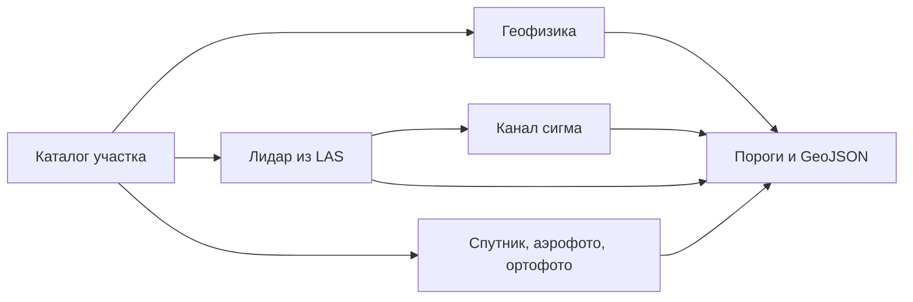

# expds-koz3

Поиск археологических объектов по лидару, спутнику, историческому аэрофото и геофизике. Сдача на официальную метрику КОЗ №3 «Комплексирование»: семь классов, один GeoJSON на участок, сопоставление по классу по всей территории, а не по типу съёмки.

Код этого репозитория на GitHub открыт. Выборка, кэши тайлов, журналы прогонов и ключи хранилища в git не входят. В репозитории лежат код и веса, на которые ссылается `configs/default.toml`.

## Состояние

Ревизия входа — 14.11.2026. Две сборки. Путать их нельзя.

Публичный балл **0,4327384661** (в журнале **0,43274**) — архив `v2_c5in_R.zip` (sha256 `98e0ab74…`). Его собирает `kaggle/2026-11-05/li_cnx_in/make_candidate.py --variant R` поверх v2: курганы лидара заменяет ConvNeXt-T c5-in. Вторая посылка — **0,41238**, архив v2 (`eb268d6`). Протокол квалификации от 13.11: команда StrataTrace, 33-е место из 100. Журнал площадки — [`docs/LB_LOG.md`](docs/LB_LOG.md).

`configs/default.toml` не собирает архив 0,43274: `[li_cnx] enabled = false`. `scripts/build_submission.py` берёт пути и флаги этого файла. Включить здесь c5-in значит собрать другую посылку. Пороги по публичному табло не двигались.

Финал ищет объекты по снимкам, облаку и планшетам, в том числе там, где памятника нет в справочнике. Сдача не читает список известных координат, не меняет веса на валидации и не зашивает ответ под имя участка. Яркость и диапазон карты на прогоне нормализовать можно. Широта в рабочем пути выбирает зону UTM и переводит метр EPSG:3857 в метр на земле. Разбор письма 06.11 — [`docs/FINAL_LETTER_20261106.md`](docs/FINAL_LETTER_20261106.md).

Письмо организаторов от 13.11 задаёт окно финала: с 17.11.2026 10:00 до 19.11.2026 23:59 МСК, 3 успешные попытки и до 10 любых. В рейтинг идёт закрытая выборка. Её балл до объявления результатов не публикуется. Если команда ничего не загрузит, платформа берёт две лучшие публичные посылки, 0,43274 и 0,41238. Обе собраны на базе v2 с геофизикой прежней реализации (`docs/AUDIT_2026-11-05.md` §2). План по баллу — [`docs/plans/AI_PLAN_20261114.md`](docs/plans/AI_PLAN_20261114.md).

Чистая геофизика E1_G1 на площадке дала **0,38988**. Сложение её с c5-in R по независимости классов даёт 0,41024 и лежит ниже обеих публичных посылок. Обвязка E1_G1 есть только в архиве `ed51cae4`. Эта пара попытку финала не получает. Расчёт — [`docs/VERIFY_2026-11-12.md`](docs/VERIFY_2026-11-12.md), разбор вариантов от 12.11 — [`docs/plans/AI_PLAN_20261112.md`](docs/plans/AI_PLAN_20261112.md).

### Что закрыто 14.11

Порог гейта: Δ ≥ +0,003 и P(Δ>0) ≥ 0,95, если в строке не назван другой. В архив 0,43274 ни одна строка не входит. На платформу эти замеры не загружались.

| Замер | Результат | Файл |
|---|---|---|
| c12-in вместо c5-in | свой гейт не пройден, линия остаётся c5-in | `kaggle/2026-11-05/li_c12_in/gate_c12in_ctx.json` |
| ансамбль c5+c12 | против c5 Δ +0,001988 при P 0,7825, порог P ≥ 0,9 не пройден | `kaggle/2026-11-05/li_ens_in/gate_e512in_ctx.json` |
| диски 0,05 м у архитектуры, `object_poly` и фортификаций | Δ +0,001970, P 0,9995 | `kaggle/2026-11-05/li_cnx_in/gate_disks_p1.json` |
| YOLO26s поверх спутника | Δ +0,002218, P 0,8735. Повреждённые курганы: +28 попаданий и +310 ложных | `kaggle/2026-11-13/spor_yolo_k/gate_yolo_k.json` |
| хедж второго класса кургана | Δ −0,000238, P 0,0355 | `kaggle/2026-11-13/spor_yolo_k/gate_hedge.json` |
| согласие двух карт, порог ×0,85 в радиусе 16 м | 302 объекта, Δ −0,000238, P 0,37 | `kaggle/2026-11-13/spor_yolo_k/gate_agree.json` |

Разложение чужого шага v11→v12 — [`docs/V12_ATOMIC_20261114.md`](docs/V12_ATOMIC_20261114.md). Просмотр репозиториев 14.11 — [`docs/OSINT_SOTA_20261114.md`](docs/OSINT_SOTA_20261114.md).

12.11: битая мозаика больше не оставляет курганы только последней сети лидара, а умершее предварительное чтение окна больше не останавливает снимок, который уже открыт. На целом входе пиксели и список прежние. Разбор — [`docs/AUDIT_2026-11-12.md`](docs/AUDIT_2026-11-12.md).

Вечер 06.11: битый файл, окно или шаг сдачи больше не стирает объекты, которые соседний проход уже нашёл. Быстрые пути с тем же выходом до бита идут при `[speed] enabled = false`: круги, запись, каналы, загрузка весов и чтение следующего окна своим дескриптором GDAL. Слоты CUDA, половинная точность и `OMP_NUM_THREADS=8` опубликованного образа не менялись. Публичное табло после этих правок не переснималось.

## Выход

Платформа вызывает `inference/main.py` с папкой выборки и путём результата. Ответ — один FeatureCollection в EPSG:3857, геометрия только Polygon.

Попадание полигона: покрытие не меньше половины меньшей фигуры и внутренняя точка внутри эталона. Попадание находки: центроид предсказания не дальше 2 м от эталонной точки. Лишнее срабатывание весит половину пропуска. Сопоставление идёт по классу сразу по всем участкам: `region_name` и `markup_type` на него не влияют. Для класса с $G$ эталонами, $t$ попаданиями и $f$ лишними $F = 2t/(G+t+0{,}5f)$. Добавка окупается, если попадает чаще $F/(4-F)$, где $F$ — балл всего класса, а не одной ветки (`docs/VERIFY_2026-11-12.md`). По утверждённому ТР (Прил. 1 п. 3, Прил. 3) файл отклоняется за размер больше 100 МБ, больше 20 000 объектов или больше 50 замечаний валидатора геометрии (незамкнутое кольцо, кольцо длиннее 3000 точек, самопересечение, площадь ≤ 0 или > 1e12, координата вне ±1e8/NaN/(0,0), больше 15 знаков после запятой). Объект с неизвестным `class_name` пропускается, файл из‑за него не отклоняется. `expds/writer.py` держит все лимиты с запасом: ≤ 3000 вершин, ≤ 20 000 объектов, ≤ 97 МБ, координаты с 2 знаками, невалидные после округления объекты отбрасываются; `validate()` и `scripts/check_submission.py` считают замечания. Сверка — [`docs/COMPLIANCE_2026-10-29.md`](docs/COMPLIANCE_2026-10-29.md), правила — [`docs/RULES.md`](docs/RULES.md).

| Класс | Вес |
|---|---|
| Повреждённые курганы | 30 |
| Целые курганы | 20 |
| Городища | 15 |
| Архитектура | 10 |
| Площадные объекты геофизики | 10 |
| Находки | 10 |
| Фортификации | 5 |

Класс `structure.poly` метрика не считает, в ответ он не пишется. Модальность, которой нет в регламенте, каталог пропускает.

## Метод

Таблица ниже — то, что считает `configs/default.toml`. В архиве 0,43274 курганы групп `li`, `li_coarse` и `li_mosaic` заменены головой c5-in; спутник, аэрофото, ортофото и геофизика на площадке совпали с v2 (`docs/LB_LOG.md`).

Одна сеть на все датчики здесь проигрывает постановке: курган, размеченный и на лидаре, и на снимке, — два эталона. Поэтому позднее слияние. Каждая ветка учится на своём типе съёмки, порог ветки снимается официальной метрикой на других семьях участков и лежит в `configs/default.toml`. По публичному баллу пороги не двигаются. Их журнал записывает рост 0,17023→0,50190. После починки лидара самый большой шаг площадки — v11→v12, +0,04842. Это пачка правок. Шестой член на их спутниковом счёте даёт +0,0047 и их приёмку не проходит. Разложение — [`docs/V12_ATOMIC_20261114.md`](docs/V12_ATOMIC_20261114.md), лестница посылок — [`docs/COMPETITOR_SCORES_20261112.md`](docs/COMPETITOR_SCORES_20261112.md). Замена всего нашего спутника одним детектором на площадке дала 0,38441.

Сети — U-Net с энкодером ResNet-18 ([Ronneberger et al., 2015](https://arxiv.org/abs/1505.04597), segmentation_models.pytorch). Курганы и другие мелкие цели, где зачёт идёт по центру, учатся как карта центров с фокальной потерей. Городища и фортификации учатся как маска: у них зачёт по площади.

| Данные | Что считает сдача |
|---|---|
| Лидар | ЦМР из LAS, локальный рельеф в окнах 8 и 30 м и уклон. Курганы — пики рельефа, уверенность берётся у сети в центре пика. Городища и фортификации — отдельные маски. Площадка с обрывом даёт маленький круг городища со своей ЦМР 0,5 м. Облако, которое не влезает в мелкую сетку, идёт со своей группы порога. Шероховатость и кривизна считаются из того же облака только по запросу кэша и в сданных весах не стоят. |
| Канал σ | Вторая сеть лидара. Круг остаётся, только если он дальше 12 м от кургана, который основной порог уже оставляет. |
| Спутник | Городища маской, курганы картой центров, архитектура кругами. На участке без LAS те же курганы читаются ещё окном 256 м. |
| Аэрофото | Маска фортификаций. Уверенный курган лидара копируется в аэрофото там, где снимок покрывает точку: на снимках 1940-х насыпь часто ещё целая. Копия мелкой сетки получает порог аэрофото, копия мозаики — свой. |
| Геофизика | Классический детектор. Уверенность находки — ранг пика внутри своей карты: растяжение контраста между планшетами несопоставимо. Цветная копия серой карты и срез глубже 2 м не читаются. Срезы и профили электроразведки не склеиваются: каждый слой — отдельный эталон. |
| Запас | Если сеть лидара не загрузилась, курганы считает детектор пиков и LightGBM. |



Каналы лидара на обучении и на инференсе строит одна функция из LAS. Готовых отмывок на валидации нет, поэтому модель не переносится с карт Li трейна. Инференс в FP32. На GTX 16xx половинная точность даёт NaN. На RTX 4090 TF32 сдвигает уверенность относительно порогов, снятых в FP32, поэтому свёртки cuDNN остаются в IEEE FP32.

Тяжёлые шаги ЦМР, отмывок и пиков — в Rust (`expds_core`). У каждого есть тот же результат на NumPy. Триангуляцию Делоне по потокам не делят: другой порядок вершин меняет высоты.

Городища по форме рельефа в `configs/default.toml` включены: одно окно, радиус второго окна равен нулю. Ортофото читает ту же сеть архитектуры, что спутник (`models/surf_arch_r18.pt`), группа порога `or`. Сеть на картах магниторазведки закомментирована. Пиксельный бустинг геофизики в этом файле выключен (`[geophys.pixgbm] enabled = false`). Публичные баллы — `docs/LB_LOG.md`. Опыты октября — `docs/PLAN.md`. Какой файл ещё живой, а какой журнал своей даты — `docs/DOCS.md`.

## Состав

```
expds/            пайплайн: каталог, CRS, лидар, геофизика, сети, пороги, запись
rust/expds_core/  LAS, заливка ЦМР, отмывки, пики
inference/        точка входа платформы
configs/          пороги и веса сдачи
models/           веса из конфига
scripts/          сборка Rust, архив, честное табло
tests/            синтетика
docs/             архитектура, журнал, лицензии, декларация
```

Как платформа вызывает код — `docs/ARCHITECTURE.md`.

## Установка

Windows 11 или Linux, Python 3.12.

```bash
python -m venv .venv
.venv\Scripts\activate
pip install torch==2.11.0 torchvision==0.26.0 --index-url https://download.pytorch.org/whl/cu128
pip install -r requirements.lock
pip install -r requirements-dev.txt
python scripts/build_rust.py dev
pytest -q
```

Для контейнера платформы Rust собирается так: `python scripts/build_rust.py linux --docker`. Образ в `docker/Dockerfile` — только окружение. Имя опубликованного образа — в `metadata.json`.

## Запуск

```bash
python inference/main.py ПАПКА_ВЫБОРКИ work/result.geojson
python -m expds.writer check work/result.geojson
python scripts/build_submission.py
```

Архив — `dist/submission.zip`, не больше 2 ГБ. В него попадают пути из `configs/default.toml` и LightGBM. Официальный файл метрики в архив не кладётся.

## Обучение

Семья — первое слово названия участка. Проверка — участок этой семьи, которого не было в обучении.

```bash
python -m expds.tiles --root КОРЕНЬ --gt work/gt_train.geojson --markup li --out work/cache/li --res 0.5 --tile 256
python -m expds.train --cache work/cache/li --out models/li.pt --epochs 30 --batch 16 --val-families СЕМЬЯ --workers 0
```

Для лидара каналы по умолчанию: `lrm_s`, `lrm_l`, `slope`. Они не зависят от направления света, тайлы можно поворачивать. Канал отмывки `g` повороты выключает.

Пороги:

```bash
set EXPDS_METRIC=ПУТЬ/compute_metrics.py
python -m expds.metric sweep --pred work/oof.geojson --gt work/gt_train.geojson --markup li --bootstrap 300 --out work/thresholds.json
```

Честный перебор групп — `scripts/scoreboard.py --honest 10`. Порог, который идёт в конфиг, берётся с совместного оптимума классов.

## Документы

Правила — `docs/RULES.md`. Как платформа вызывает код — `docs/ARCHITECTURE.md`. Описание для шаблона организаторов — `docs/README.md`. Обложка пакета — `docs/README_FINAL.md`. Проверка физики и математики — `docs/VERIFY_2026-11-12.md`. План по баллу — `docs/plans/AI_PLAN_20261114.md`. План документов и чистой пары от 12.11 — `docs/plans/AI_PLAN_20261112.md`. Идеи конкурентов — `docs/OSINT_SOTA_20261114.md`, разбор 12.11 — `docs/OSINT_SOTA_20261112.md`. Лестница их балла — `docs/COMPETITOR_SCORES_20261112.md`. Разложение шага v11→v12 — `docs/V12_ATOMIC_20261114.md`. Карта документов — `docs/DOCS.md`.
