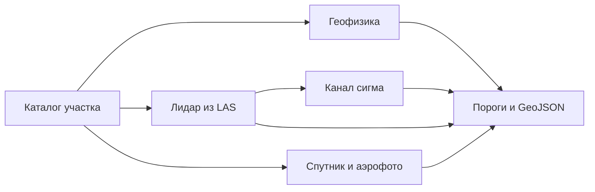

# expds-koz3

Поиск археологических объектов по лидару, спутнику, историческому аэрофото и геофизике. Сдача на официальную метрику КОЗ №3 «Комплексирование»: семь классов, один GeoJSON на участок, сопоставление по классу по всей территории, а не по типу съёмки.

Репозиторий приватный до конца конкурса. В нём код и веса из `configs/default.toml`. Выборка, кэши тайлов, журналы прогонов и ключи хранилища в git не входят.

## Состояние на 29.10

Действующая сводка — [`docs/STATUS.md`](docs/STATUS.md): база площадки 0,41238. Срез 29.10 — [`docs/STATUS_2026-10-29.md`](docs/STATUS_2026-10-29.md). Закрытые отчёты и разборы не удалены: ветка `archive/worked-20261031`, каталог `archive_review/`. Поправки — [`CHANGELOG.md`](CHANGELOG.md).

- **~12:45:**
  - **v3 `36af6b7`** — zip `9ec25962…`, ждёт сквозного прогона на ПК (ветка `archive/worked-20261031`: `archive_review/docs_bots/2026-10-29/bot-7/work6/pc/pc_e2e_v3.ps1`). Ветка: `bots/bot7-candidate-v3-nomodels` @ `dd58b4c`.
  - **План v4:** v3 + патчи бота 3 `e3c4f41` (3857) и `e0ec0ff` (dedupe) + локализатор городищ бота 5 (+0,01286 на сидах 5–9, 5/5; только пакетом, совместимость с R решает бот 10) + D-FINE Ae/Or всех классов.
  - **D-FINE Ae/Or:** обучаются Kaggle-ядра `koz3-dfine-ae`/`-or`. Фаза инференса за выключенным флагом `[dfine_aeor]` — `bots/bot6-aeor-detect-nomodels` @ `aba432d`, 29 тестов; при выключенном флаге выход идентичен v3.
  - **Принято:** ORGATE +0,0019 поверх R (только пакетом), FR1h +0,0041.
  - **Отклонено:** MORPH/RING, ADAF, ORGATE_S, SATf, CAL1, gormask, neigh, F1/F2/F12/F1s, li_decode.
  - **Крупные объекты:** 204 пропуска > 5 тыс. м² — 113 ниже порога, 82 без кандидата, 6 форма, 3 дедупликация.
  - **Риски:** в `main` нет `models/rerank_arch_lgbm.txt` (сборка из чистого клона падает); CI стоит из-за биллинга GitHub; нужен clean-room PIXGBM; honest-eval сопоставляет по участку, а не по слою.

- **LB 29.10 08:47 — 0,41238** (прежний лучший 0,34796, #33). Это v2 `eb268d6` (`submission_bot7cand_v2_eb268d6.zip` в логе площадки, `docs/background/LB_SCORING_v2_eb268d6_0.41238.log`); инференс 3 мин 48 с / 30 мин. Офлайн honest-10 давал v2 только +0,0110 / keep-all +0,0139 к A = 0,314615 — LB вырос больше, но шум публичного LB ≈ ±0,034. История: 0,06140 → 0,32850 → 0,32850 → 0,33352 → 0,34796 → 0,34757 → **0,41238** ([`docs/LB_LOG.md`](docs/LB_LOG.md)). Призы — по финалу 17–19.11 на закрытой выборке; дедлайн 11.11.
- **Разбор лога v2** ([`docs/LB_LOG.md`](docs/LB_LOG.md)): soft recall 0,622, FP ratio 1,139. Recall по типам: аэрофото **0,013** (P 0,091), ортофото 0,140, спутник 0,255, лидар 0,504, геофизика 0,656. Recall по площади GT 5–10 тыс. м² — **0**, > 10 тыс. м² — 0,294.
- **План-пивот 10:55** ([`docs/PLAN_PIVOT_2026-10-29.md`](docs/PLAN_PIVOT_2026-10-29.md)): запас по времени ~8×, цель ≤ 15 мин. Приоритеты: 1) аэрофото (D-FINE Ae + TTA, разобрать recall ≈ 0); 2) орто/спутник (D-FINE sp v3 + TTA, мультимасштаб); 3) крупные объекты (городища/форты, фильтры по площади/NMS); 4) лидар (tile TTA, ConvNeXt c3). Всё через honest-10, по умолчанию OFF. Финал: до 10 попыток, 2 успешные — финальную сборку выбирать заранее. Квалификация по тексту до 14.11 (работаем к 11.11).
- **Правила организаторов 29.10** ([`docs/RULES.md`](docs/RULES.md), исходники — `docs/background/RULES_ORG_2026-10-29_*.md`): синтетика, аугментации и генеративные модели на данных КОЗ — можно; открытые датасеты — только если лицензия прямо разрешает обучение ML; Яндекс Карты — нельзя; Google/Bing/Esri — не используем; данные КОЗ №2 — нельзя. Дубли: внутри типа данных один объект = один полигон, между типами не склеивать. Лимиты результата 100 МБ / 20 000 объектов / 3000 вершин применяются.
- **Конкуренты** — [`docs/COMPETITORS_2026-10-29.md`](docs/COMPETITORS_2026-10-29.md) (из `research/competitors-2026-10-29`, без чужого кода).
- **v2 `eb268d6`** (бот 7): на ПК `mock_val` 649 с (лимит 1200), RAM 4,62 GiB, VRAM 3,1 ГБ. Старые v2 `67284ab` / `af97af0` **не сдавать** (зависание fork-пула PIXGBM на SIGTERM). Код без весов — `bots/bot7-candidate-v2-nomodels`.
- **v3 `8857343`**: D-FINE-L COCO на SpOr принят условно (+0,0198, P 0,985, 5/5); нужны замер на 4090, сквозное v3 против v2 и финальная модель вместо f0. Код без весов — `bots/bot7-candidate-v3-nomodels` (`d420ceb`, из `9138bff`).
- ORSP — честно +0,0025, только пакетом. li-decode — отклонён. D-FINE на Or — отложен (179/188 эталонов на Кавказе, честного OOF нет).
- **Аудит 29.10:** 0,61 не подтверждается, реалистично 0,42–0,48 (≈0,50). Главный рычаг — калибровка по участкам и ConvNeXt-лидар (0,713 против 0,476 при калибровке по участку). Функции аудита выключены по умолчанию до honest-10. Веса метрики: архитектура 10, фортификации 5.
- Предобученные веса: можно COCO, ImageNet(-21k/22k), DINOv2, Objects365, ADAF; нельзя ultralytics/YOLO, DINOv3, SAM3, SegFormer `mit_*`, некоммерческие. Данные КОЗ №2 «Сканирование» (`ackrome/satelite-scan`) **запрещены** и удалены.
- Kaggle-очередь: c3-f4 → dfine-spor-final → c3in-f01 → ae_o2c → c3in-f23.
- Выгрузка 29.10 — ветка `archive/worked-20261031`, `archive_review/docs_bots/2026-10-29/README.md`.

## Выход

Платформа вызывает `inference/main.py` с папкой выборки и путём результата. Ответ — один FeatureCollection в EPSG:3857, геометрия только Polygon.

Попадание полигона: покрытие не меньше половины меньшей фигуры и внутренняя точка внутри эталона. Попадание точки: центр не дальше 2 м. Лишнее срабатывание весит половину пропуска. По утверждённому ТР (Прил. 1 п. 3, Прил. 3) файл отклоняется за размер больше 100 МБ, больше 20 000 объектов или больше 50 замечаний валидатора геометрии (незамкнутое кольцо, кольцо длиннее 3000 точек, самопересечение, площадь ≤ 0 или > 1e12, координата вне ±1e8/NaN/(0,0), больше 15 знаков после запятой). Объект с неизвестным `class_name` пропускается, файл из‑за него не отклоняется. `expds/writer.py` держит все лимиты с запасом: ≤ 3000 вершин, ≤ 20 000 объектов, ≤ 97 МБ, координаты с 2 знаками, невалидные после округления объекты отбрасываются; `validate()` и `scripts/check_submission.py` считают замечания. Сверка — [`docs/COMPLIANCE_2026-10-29.md`](docs/COMPLIANCE_2026-10-29.md), правила — [`docs/RULES.md`](docs/RULES.md).

| Класс | Вес |
|---|---|
| Повреждённые курганы | 30 |
| Целые курганы | 20 |
| Городища | 15 |
| Архитектура | 10 |
| Площадные объекты геофизики | 10 |
| Находки | 10 |
| Фортификации | 5 |

Класс `structure.poly` метрика не считает, в ответ он не пишется. Модальность, которой нет в регламенте, каталог пропускает.

## Метод

Одна сеть на все датчики здесь проигрывает постановке: курган, размеченный и на лидаре, и на снимке, — два эталона. Поэтому позднее слияние. Каждая ветка учится на своём типе съёмки, порог ветки снимается официальной метрикой на других семьях участков и лежит в `configs/default.toml`. По публичному баллу пороги не двигаются.

Сети — U-Net с энкодером ResNet-18 ([Ronneberger et al., 2015](https://arxiv.org/abs/1505.04597), segmentation_models.pytorch). Курганы и другие мелкие цели, где зачёт идёт по центру, учатся как карта центров с фокальной потерей. Городища и фортификации учатся как маска: у них зачёт по площади.

| Данные | Что считает сдача |
|---|---|
| Лидар | ЦМР из LAS, локальный рельеф в окнах 8 и 30 м и уклон. Курганы — пики рельефа, уверенность берётся у сети в центре пика. Городища и фортификации — отдельные маски. Площадка с обрывом даёт маленький круг городища со своей ЦМР 0,5 м. Облако, которое не влезает в мелкую сетку, идёт со своей группы порога. Шероховатость и кривизна считаются из того же облака только по запросу кэша и в сданных весах не стоят. |
| Канал σ | Вторая сеть лидара. Круг остаётся, только если он дальше 12 м от кургана, который основной порог уже оставляет. |
| Спутник | Городища маской, курганы картой центров, архитектура кругами. На участке без LAS те же курганы читаются ещё окном 256 м. |
| Аэрофото | Маска фортификаций. Уверенный курган лидара копируется в аэрофото там, где снимок покрывает точку: на снимках 1940-х насыпь часто ещё целая. Копия мелкой сетки получает порог аэрофото, копия мозаики — свой. |
| Геофизика | Классический детектор. Уверенность находки — ранг пика внутри своей карты: растяжение контраста между планшетами несопоставимо. Цветная копия серой карты и срез глубже 2 м не читаются. Срезы и профили электроразведки не склеиваются: каждый слой — отдельный эталон. |
| Запас | Если сеть лидара не загрузилась, курганы считает детектор пиков и LightGBM. |



Каналы лидара на обучении и на инференсе строит одна функция из LAS. Готовых отмывок на валидации нет, поэтому модель не переносится с карт Li трейна. Инференс в FP32. На GTX 16xx половинная точность даёт NaN. На RTX 4090 TF32 сдвигает уверенность относительно порогов, снятых в FP32, поэтому свёртки cuDNN остаются в IEEE FP32.

Тяжёлые шаги ЦМР, отмывок и пиков — в Rust (`expds_core`). У каждого есть тот же результат на NumPy. Триангуляцию Делоне по потокам не делят: другой порядок вершин меняет высоты.

Генератор городищ по форме рельефа и сеть на картах магниторазведки в конфиге выключены до честного табло. Журнал измерений — `docs/PLAN.md`.

## Оценка

Площадка дважды вернула **0,32850**. Честный балл того же стека до окна 256 м и канала σ, одна семья на фолд, — **0,329489**. Балл **0,353793** получен, когда порог семьи подбирался на ней же. Это замер полноты стека на обучении, не оценка площадки. Журнал посылок — `docs/LB_LOG.md`.

## Состав

```
expds/            пайплайн: каталог, CRS, лидар, геофизика, сети, пороги, запись
rust/expds_core/  LAS, заливка ЦМР, отмывки, пики
inference/        точка входа платформы
configs/          пороги и веса сдачи
models/           веса из конфига
scripts/          сборка Rust, архив, честное табло
tests/            синтетика
docs/             архитектура, журнал, лицензии, декларация
```

Как платформа вызывает код — `docs/ARCHITECTURE.md`.

## Установка

Windows 11 или Linux, Python 3.12.

```bash
python -m venv .venv
.venv\Scripts\activate
pip install torch==2.11.0 torchvision==0.26.0 --index-url https://download.pytorch.org/whl/cu128
pip install -r requirements.lock
pip install -r requirements-dev.txt
python scripts/build_rust.py dev
pytest -q
```

Для контейнера платформы Rust собирается так: `python scripts/build_rust.py linux --docker`. Образ в `docker/Dockerfile` — только окружение. Имя опубликованного образа — в `metadata.json`.

## Запуск

```bash
python inference/main.py ПАПКА_ВЫБОРКИ work/result.geojson
python -m expds.writer check work/result.geojson
python scripts/build_submission.py
```

Архив — `dist/submission.zip`, не больше 2 ГБ. В него попадают пути из `configs/default.toml` и LightGBM. Официальный файл метрики в архив не кладётся.

## Обучение

Семья — первое слово названия участка. Проверка — участок этой семьи, которого не было в обучении.

```bash
python -m expds.tiles --root КОРЕНЬ --gt work/gt_train.geojson --markup li --out work/cache/li --res 0.5 --tile 256
python -m expds.train --cache work/cache/li --out models/li.pt --epochs 30 --batch 16 --val-families СЕМЬЯ --workers 0
```

Для лидара каналы по умолчанию: `lrm_s`, `lrm_l`, `slope`. Они не зависят от направления света, тайлы можно поворачивать. Канал отмывки `g` повороты выключает.

Пороги:

```bash
set EXPDS_METRIC=ПУТЬ/compute_metrics.py
python -m expds.metric sweep --pred work/oof.geojson --gt work/gt_train.geojson --markup li --bootstrap 300 --out work/thresholds.json
```

Честный перебор групп — `scripts/scoreboard.py --honest 10`. Порог, который идёт в конфиг, берётся с совместного оптимума классов.

## Документы

| Файл | Зачем |
|---|---|
| `docs/ARCHITECTURE.md` | четыре прохода и состав конфига |
| `docs/PLAN.md` | измерения и отклонённые ветки |
| `docs/LB_LOG.md` | посылки на площадку |
| `docs/THIRD_PARTY.md` | лицензии |
| `docs/DATA_PROTOCOL.md` | конкурсные данные |
| `docs/AI_DECLARATION.md` | журнал инструментов |
| `docs/PLAN_PIVOT_2026-10-29.md` | разворот плана после лога LB v2: приоритеты аэро → орто/спутник → крупные → лидар |
| `docs/COMPETITORS_2026-10-29.md` | обзор конкурентов и идеи (без чужого кода) |
| `docs/STATUS_2026-10-29.md` | состояние на 29.10: LB 0,41238, кандидаты v2/v3, аудит, принятые компоненты, работы ботов |
| `CHANGELOG.md` | поправки к документам и промтам |
| `docs/STATUS_2026-10-28.md` | статус, очередь Kaggle, прогноз на 11.11 |
| `docs/EXPERIMENTS.md` | все замеры: Δ, P, LOFO, статус, ссылка на отчёт |
| `docs/REASONING_AND_DISCOVERY_LOG_2026-10-28.md` | журнал рассуждений и находок |
| `docs/research/2026-10-28/` | аудит, OSINT, SOTA, общие правила, ускорение |
| ветка `archive/worked-20261031`, `archive_review/docs_bots/2026-10-28/` | отчёты ботов 2–10 и результаты замеров |
| `analysis/2026-10-28/bots/` | скрипты анализа ботов |
| `kaggle/2026-10-28/` | исходники Kaggle-ядер и логи прогонов |
| `patches/2026-10-28/` | патчи ботов |
| ветка `archive/worked-20261031`: `archive_review/docs_bots/2026-10-29/`, `archive_review/analysis/2026-10-29/`; на main: `kaggle/2026-10-29/`, `patches/2026-10-29/`, `docs/research/2026-10-29/` | выгрузка 29.10 (дельта к 28.10) |
| ветки `bots/*` | код ботов, не слитый в main |

## Ограничения

Веса энкодера — ImageNet. 29.10 организаторы разрешили предобученные веса COCO, ImageNet и DINOv2. Запасной путь — обучение с `--no-pretrained`. Библиотеки, чья лицензия несовместима с передачей исключительных прав, не используются.
