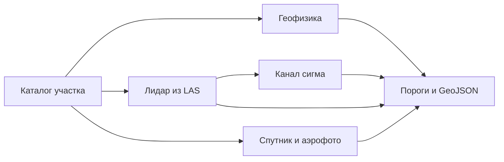

# expds-koz3

Поиск археологических объектов по лидару, спутнику, историческому аэрофото и геофизике. Сдача на официальную метрику КОЗ №3 «Комплексирование»: семь классов, один GeoJSON на участок, сопоставление по классу по всей территории, а не по типу съёмки.

Репозиторий приватный до конца конкурса. В нём код и веса из `configs/default.toml`. Выборка, кэши тайлов, журналы прогонов и ключи хранилища в git не входят.

## Состояние на 03.11

- **Один `main`.** 03.11 в него сведены все ветки и PR (40 веток, PR #16–#30): `docs/AUDIT_2026-11-03.md` §3. Резервные копии и архив закрытых отчётов влиты стратегией `ours`: их коммиты достижимы из `main`, файлы — на своих ветках. Код линии EN (`expds/geo_pixgbm.py`) в `main` не входит.
- **LB:** лучший **0,41238** (29.10, v2 `eb268d6`, с PIXGBM линии EN). Посылка без PIXGBM (v3a_min, 30.10) — 0,37838. История — `docs/LB_LOG.md`.
- **Финал (не на LB):** **v4** = v3_on `b447649` + `scene_drel` + C1F-all (`configs/v4_c1f.toml`, архив `f0def982…`, Kaggle-паритет PASS). Honest-10: v4 **0,361641** против v3_on 0,345439 (Δ+0,0162, P 1,0). Порядок посылок (Елена после «да» Дмитрия): v4 → v3_on `1406c01a…` → v2clean `545ef32a…`. Подробно — `orch/HANDOFF_NOW_20261102.md`.
- **`configs/default.toml`** — консервативная база без PIXGBM и реранка: не v2 и не v4. Архив финала собирается `scripts/build_submission_git.py --config configs/v4_c1f.toml`.
- **Аудит 03.11:** исправлены запись ответа по SIGTERM (A1, A2) и тест, который клал код EN и веса v2 в рабочее дерево (A3). Выход по умолчанию побайтно прежний. Отчёт — `docs/AUDIT_2026-11-03.md`.
- **Дальше (04.11):** `docs/plans/PROMPT_TO_061_20261103.md`, журнал гейтов — `docs/STATUS.md`. За 03–04.11 на восстановленном боксе проверено 11 вариантов, все FAIL: ансамбль D-FINE f0 + D-FINE-2 (B, C, C2, C3 — минус на 34 новых участках), сеть городищ/архитектуры спутника `sat_cl` (голова архитектуры схлопнулась) и `sat_cl2` (E1/E2 минус по городищам; E3 «только архитектура» Δ+0,0030, но P 0,93 — `kaggle/2026-11-04/sat_cl2/PREREG.md`), копии городищ и фортов лидара в оптику. Сеть городищ/архитектуры SpOr до сдачи не открывать. Почему балл низкий — `docs/WHY_LOW_SCORE_2026-11-03.md`; конкуренты по коду — `docs/COMPETITORS_ATOMIC.md`. Лидер 0,618 работает на том же стеке smp/timm.
- Правила организаторов — `docs/RULES.md`; веса COCO / ImageNet / DINOv2 / Objects365 разрешены; данные КОЗ №2, YOLO/ultralytics и Яндекс Карты — нет.

## Выход

Платформа вызывает `inference/main.py` с папкой выборки и путём результата. Ответ — один FeatureCollection в EPSG:3857, геометрия только Polygon.

Попадание полигона: покрытие не меньше половины меньшей фигуры и внутренняя точка внутри эталона. Попадание точки: центр не дальше 2 м. Лишнее срабатывание весит половину пропуска. По утверждённому ТР (Прил. 1 п. 3, Прил. 3) файл отклоняется за размер больше 100 МБ, больше 20 000 объектов или больше 50 замечаний валидатора геометрии (незамкнутое кольцо, кольцо длиннее 3000 точек, самопересечение, площадь ≤ 0 или > 1e12, координата вне ±1e8/NaN/(0,0), больше 15 знаков после запятой). Объект с неизвестным `class_name` пропускается, файл из‑за него не отклоняется. `expds/writer.py` держит все лимиты с запасом: ≤ 3000 вершин, ≤ 20 000 объектов, ≤ 97 МБ, координаты с 2 знаками, невалидные после округления объекты отбрасываются; `validate()` и `scripts/check_submission.py` считают замечания. Сверка — [`docs/COMPLIANCE_2026-10-29.md`](docs/COMPLIANCE_2026-10-29.md), правила — [`docs/RULES.md`](docs/RULES.md).

| Класс | Вес |
|---|---|
| Повреждённые курганы | 30 |
| Целые курганы | 20 |
| Городища | 15 |
| Архитектура | 10 |
| Площадные объекты геофизики | 10 |
| Находки | 10 |
| Фортификации | 5 |

Класс `structure.poly` метрика не считает, в ответ он не пишется. Модальность, которой нет в регламенте, каталог пропускает.

## Метод

Одна сеть на все датчики здесь проигрывает постановке: курган, размеченный и на лидаре, и на снимке, — два эталона. Поэтому позднее слияние. Каждая ветка учится на своём типе съёмки, порог ветки снимается официальной метрикой на других семьях участков и лежит в `configs/default.toml`. По публичному баллу пороги не двигаются.

Сети — U-Net с энкодером ResNet-18 ([Ronneberger et al., 2015](https://arxiv.org/abs/1505.04597), segmentation_models.pytorch). Курганы и другие мелкие цели, где зачёт идёт по центру, учатся как карта центров с фокальной потерей. Городища и фортификации учатся как маска: у них зачёт по площади.

| Данные | Что считает сдача |
|---|---|
| Лидар | ЦМР из LAS, локальный рельеф в окнах 8 и 30 м и уклон. Курганы — пики рельефа, уверенность берётся у сети в центре пика. Городища и фортификации — отдельные маски. Площадка с обрывом даёт маленький круг городища со своей ЦМР 0,5 м. Облако, которое не влезает в мелкую сетку, идёт со своей группы порога. Шероховатость и кривизна считаются из того же облака только по запросу кэша и в сданных весах не стоят. |
| Канал σ | Вторая сеть лидара. Круг остаётся, только если он дальше 12 м от кургана, который основной порог уже оставляет. |
| Спутник | Городища маской, курганы картой центров, архитектура кругами. На участке без LAS те же курганы читаются ещё окном 256 м. |
| Аэрофото | Маска фортификаций. Уверенный курган лидара копируется в аэрофото там, где снимок покрывает точку: на снимках 1940-х насыпь часто ещё целая. Копия мелкой сетки получает порог аэрофото, копия мозаики — свой. |
| Геофизика | Классический детектор. Уверенность находки — ранг пика внутри своей карты: растяжение контраста между планшетами несопоставимо. Цветная копия серой карты и срез глубже 2 м не читаются. Срезы и профили электроразведки не склеиваются: каждый слой — отдельный эталон. |
| Запас | Если сеть лидара не загрузилась, курганы считает детектор пиков и LightGBM. |



Каналы лидара на обучении и на инференсе строит одна функция из LAS. Готовых отмывок на валидации нет, поэтому модель не переносится с карт Li трейна. Инференс в FP32. На GTX 16xx половинная точность даёт NaN. На RTX 4090 TF32 сдвигает уверенность относительно порогов, снятых в FP32, поэтому свёртки cuDNN остаются в IEEE FP32.

Тяжёлые шаги ЦМР, отмывок и пиков — в Rust (`expds_core`). У каждого есть тот же результат на NumPy. Триангуляцию Делоне по потокам не делят: другой порядок вершин меняет высоты.

Генератор городищ по форме рельефа и сеть на картах магниторазведки в конфиге выключены до честного табло. Журнал измерений — `docs/PLAN.md`.

## Оценка

Площадка дважды вернула **0,32850**. Честный балл того же стека до окна 256 м и канала σ, одна семья на фолд, — **0,329489**. Балл **0,353793** получен, когда порог семьи подбирался на ней же. Это замер полноты стека на обучении, не оценка площадки. Журнал посылок — `docs/LB_LOG.md`.

## Состав

```
expds/            пайплайн: каталог, CRS, лидар, геофизика, сети, пороги, запись
rust/expds_core/  LAS, заливка ЦМР, отмывки, пики
inference/        точка входа платформы
configs/          пороги и веса сдачи
models/           веса из конфига
scripts/          сборка Rust, архив, честное табло
tests/            синтетика
docs/             архитектура, журнал, лицензии, декларация
```

Как платформа вызывает код — `docs/ARCHITECTURE.md`.

## Установка

Windows 11 или Linux, Python 3.12.

```bash
python -m venv .venv
.venv\Scripts\activate
pip install torch==2.11.0 torchvision==0.26.0 --index-url https://download.pytorch.org/whl/cu128
pip install -r requirements.lock
pip install -r requirements-dev.txt
python scripts/build_rust.py dev
pytest -q
```

Для контейнера платформы Rust собирается так: `python scripts/build_rust.py linux --docker`. Образ в `docker/Dockerfile` — только окружение. Имя опубликованного образа — в `metadata.json`.

## Запуск

```bash
python inference/main.py ПАПКА_ВЫБОРКИ work/result.geojson
python -m expds.writer check work/result.geojson
python scripts/build_submission.py
```

Архив — `dist/submission.zip`, не больше 2 ГБ. В него попадают пути из `configs/default.toml` и LightGBM. Официальный файл метрики в архив не кладётся.

### Release candidate (one command)

Профиль + inject v2 + сборка + compliance:

```bash
python scripts/assemble_release.py --profile off
```

Профили: `off` / `fr1h` / `sat2` / `dfine_ae` / `fr1h_sat2_dfine_ae`. Подробности — `docs/RELEASE_BUILD.md`.

## Обучение

Семья — первое слово названия участка. Проверка — участок этой семьи, которого не было в обучении.

```bash
python -m expds.tiles --root КОРЕНЬ --gt work/gt_train.geojson --markup li --out work/cache/li --res 0.5 --tile 256
python -m expds.train --cache work/cache/li --out models/li.pt --epochs 30 --batch 16 --val-families СЕМЬЯ --workers 0
```

Для лидара каналы по умолчанию: `lrm_s`, `lrm_l`, `slope`. Они не зависят от направления света, тайлы можно поворачивать. Канал отмывки `g` повороты выключает.

Пороги:

```bash
set EXPDS_METRIC=ПУТЬ/compute_metrics.py
python -m expds.metric sweep --pred work/oof.geojson --gt work/gt_train.geojson --markup li --bootstrap 300 --out work/thresholds.json
```

Честный перебор групп — `scripts/scoreboard.py --honest 10`. Порог, который идёт в конфиг, берётся с совместного оптимума классов.

## Документы

| Файл | Зачем |
|---|---|
| `docs/ARCHITECTURE.md` | четыре прохода и состав конфига |
| `docs/PLAN.md` | измерения и отклонённые ветки |
| `docs/LB_LOG.md` | посылки на площадку |
| `docs/THIRD_PARTY.md` | лицензии |
| `docs/DATA_PROTOCOL.md` | конкурсные данные |
| `docs/AI_DECLARATION.md` | журнал инструментов |
| `docs/PLAN_PIVOT_2026-10-29.md` | разворот плана после лога LB v2: приоритеты аэро → орто/спутник → крупные → лидар |
| `docs/COMPETITORS_2026-10-29.md` | обзор конкурентов и идеи (без чужого кода) |
| `docs/AUDIT_2026-11-03.md` | аудит и сведение веток 03.11 |
| `docs/plans/PROMPT_TO_061_20261103.md` | задание ботам: гейты поверх v4 |
| `orch/HANDOFF_NOW_20261102.md` | финальные архивы, порядок посылок, закрытые рычаги |
| `docs/STATUS_2026-10-29.md` | состояние на 29.10: LB 0,41238, кандидаты v2/v3, аудит, принятые компоненты, работы ботов |
| `CHANGELOG.md` | поправки к документам и промтам |
| `docs/STATUS_2026-10-28.md` | статус, очередь Kaggle, прогноз на 11.11 |
| `docs/EXPERIMENTS.md` | все замеры: Δ, P, LOFO, статус, ссылка на отчёт |
| `docs/REASONING_AND_DISCOVERY_LOG_2026-10-28.md` | журнал рассуждений и находок |
| `docs/research/2026-10-28/` | аудит, OSINT, SOTA, общие правила, ускорение |
| ветка `archive/worked-20261031`, `archive_review/docs_bots/2026-10-28/` | отчёты ботов 2–10 и результаты замеров |
| `analysis/2026-10-28/bots/` | скрипты анализа ботов |
| `kaggle/2026-10-28/` | исходники Kaggle-ядер и логи прогонов |
| `patches/2026-10-28/` | патчи ботов |
| ветка `archive/worked-20261031`: `archive_review/docs_bots/2026-10-29/`, `archive_review/analysis/2026-10-29/`; на main: `kaggle/2026-10-29/`, `patches/2026-10-29/`, `docs/research/2026-10-29/` | выгрузка 29.10 (дельта к 28.10) |
| ветки `bots/*` | код ботов, не слитый в main |

## Ограничения

Веса энкодера — ImageNet. 29.10 организаторы разрешили предобученные веса COCO, ImageNet и DINOv2. Запасной путь — обучение с `--no-pretrained`. Библиотеки, чья лицензия несовместима с передачей исключительных прав, не используются.
