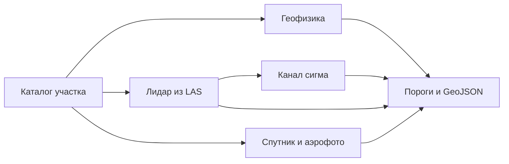

# expds-koz3

Поиск археологических объектов по лидару, спутнику, историческому аэрофото и геофизике. Сдача на официальную метрику КОЗ №3 «Комплексирование»: семь классов, один GeoJSON на участок, сопоставление по классу по всей территории, а не по типу съёмки.

Репозиторий приватный до конца конкурса. В нём код и веса из `configs/default.toml`. Выборка, кэши тайлов, журналы прогонов и ключи хранилища в git не входят.

## Выход

Платформа вызывает `inference/main.py` с папкой выборки и путём результата. Ответ — один FeatureCollection в EPSG:3857, геометрия только Polygon.

Попадание полигона: покрытие не меньше половины меньшей фигуры и внутренняя точка внутри эталона. Попадание точки: центр не дальше 2 м. Лишнее срабатывание весит половину пропуска. Неизвестный класс, файл больше 100 МБ, больше 20 000 объектов или больше 3000 вершин у полигона проверка отклоняет. Это закрывает `expds/writer.py`.

| Класс | Вес |
|---|---|
| Повреждённые курганы | 30 |
| Целые курганы | 20 |
| Городища | 15 |
| Архитектура | 10 |
| Площадные объекты геофизики | 10 |
| Находки | 10 |
| Фортификации | 5 |

Класс `structure.poly` метрика не считает, в ответ он не пишется. Модальность, которой нет в регламенте, каталог пропускает.

## Метод

Одна сеть на все датчики здесь проигрывает постановке: курган, размеченный и на лидаре, и на снимке, — два эталона. Поэтому позднее слияние. Каждая ветка учится на своём типе съёмки, порог ветки снимается официальной метрикой на других семьях участков и лежит в `configs/default.toml`. По публичному баллу пороги не двигаются.

Сети — U-Net с энкодером ResNet-18 ([Ronneberger et al., 2015](https://arxiv.org/abs/1505.04597), segmentation_models.pytorch). Курганы и другие мелкие цели, где зачёт идёт по центру, учатся как карта центров с фокальной потерей. Городища и фортификации учатся как маска: у них зачёт по площади.

| Данные | Что считает сдача |
|---|---|
| Лидар | ЦМР из LAS, локальный рельеф в окнах 8 и 30 м и уклон. Курганы — пики рельефа, уверенность берётся у сети в центре пика. Городища и фортификации — отдельные маски. Облако, которое не влезает в мелкую сетку, идёт со своей группы порога. |
| Канал σ | Вторая сеть лидара. Круг остаётся, только если он дальше 12 м от кургана, который основной порог уже оставляет. |
| Спутник | Городища маской, курганы картой центров, архитектура кругами. На участке без LAS те же курганы читаются ещё окном 256 м. |
| Аэрофото | Маска фортификаций. Уверенный курган лидара копируется в аэрофото там, где снимок покрывает точку: на снимках 1940-х насыпь часто ещё целая. Копия мелкой сетки получает порог аэрофото, копия мозаики — свой. |
| Геофизика | Классический детектор. Уверенность находки — ранг пика внутри своей карты: растяжение контраста между планшетами несопоставимо. Цветная копия серой карты и срез глубже 2 м не читаются. Срезы и профили электроразведки не склеиваются: каждый слой — отдельный эталон. |
| Запас | Если сеть лидара не загрузилась, курганы считает детектор пиков и LightGBM. |



Каналы лидара на обучении и на инференсе строит одна функция из LAS. Готовых отмывок на валидации нет, поэтому модель не переносится с карт Li трейна. Инференс в FP32. На GTX 16xx половинная точность даёт NaN. На RTX 4090 TF32 сдвигает уверенность относительно порогов, снятых в FP32, поэтому свёртки cuDNN остаются в IEEE FP32.

Тяжёлые шаги ЦМР, отмывок и пиков — в Rust (`expds_core`). У каждого есть тот же результат на NumPy. Триангуляцию Делоне по потокам не делят: другой порядок вершин меняет высоты.

Генератор городищ по форме рельефа и сеть на картах магниторазведки в конфиге выключены до честного табло. Журнал измерений — `docs/PLAN.md`.

## Оценка

Площадка дважды вернула **0,32850**. Честный балл того же стека до окна 256 м и канала σ, одна семья на фолд, — **0,329489**. Балл **0,353793** получен, когда порог семьи подбирался на ней же. Это замер полноты стека на обучении, не оценка площадки. Журнал посылок — `docs/LB_LOG.md`.

## Состав

```
expds/            пайплайн: каталог, CRS, лидар, геофизика, сети, пороги, запись
rust/expds_core/  LAS, заливка ЦМР, отмывки, пики
inference/        точка входа платформы
configs/          пороги и веса сдачи
models/           веса из конфига
scripts/          сборка Rust, архив, честное табло
tests/            синтетика
docs/             архитектура, журнал, лицензии, декларация
```

Как платформа вызывает код — `docs/ARCHITECTURE.md`.

## Установка

Windows 11 или Linux, Python 3.12.

```bash
python -m venv .venv
.venv\Scripts\activate
pip install torch==2.11.0 torchvision==0.26.0 --index-url https://download.pytorch.org/whl/cu128
pip install -r requirements.lock
pip install -r requirements-dev.txt
python scripts/build_rust.py dev
pytest -q
```

Для контейнера платформы Rust собирается так: `python scripts/build_rust.py linux --docker`. Образ в `docker/Dockerfile` — только окружение. Имя опубликованного образа — в `metadata.json`.

## Запуск

```bash
python inference/main.py ПАПКА_ВЫБОРКИ work/result.geojson
python -m expds.writer check work/result.geojson
python scripts/build_submission.py
```

Архив — `dist/submission.zip`, не больше 2 ГБ. В него попадают пути из `configs/default.toml` и LightGBM. Официальный файл метрики в архив не кладётся.

## Обучение

Семья — первое слово названия участка. Проверка — участок этой семьи, которого не было в обучении.

```bash
python -m expds.tiles --root КОРЕНЬ --gt work/gt_train.geojson --markup li --out work/cache/li --res 0.5 --tile 256
python -m expds.train --cache work/cache/li --out models/li.pt --epochs 30 --batch 16 --val-families СЕМЬЯ --workers 0
```

Для лидара каналы по умолчанию: `lrm_s`, `lrm_l`, `slope`. Они не зависят от направления света, тайлы можно поворачивать. Канал отмывки `g` повороты выключает.

Пороги:

```bash
set EXPDS_METRIC=ПУТЬ/compute_metrics.py
python -m expds.metric sweep --pred work/oof.geojson --gt work/gt_train.geojson --markup li --bootstrap 300 --out work/thresholds.json
```

Честный перебор групп — `scripts/scoreboard.py --honest 10`. Порог, который идёт в конфиг, берётся с совместного оптимума классов.

## Документы

| Файл | Зачем |
|---|---|
| `docs/ARCHITECTURE.md` | четыре прохода и состав конфига |
| `docs/PLAN.md` | измерения и отклонённые ветки |
| `docs/LB_LOG.md` | посылки на площадку |
| `docs/THIRD_PARTY.md` | лицензии |
| `docs/DATA_PROTOCOL.md` | конкурсные данные |
| `docs/AI_DECLARATION.md` | журнал инструментов |

## Ограничения

Веса энкодера — ImageNet. Письменного ответа по лицензии нет. Запасной путь — обучение с `--no-pretrained`. Библиотеки, чья лицензия несовместима с передачей исключительных прав, не используются.
