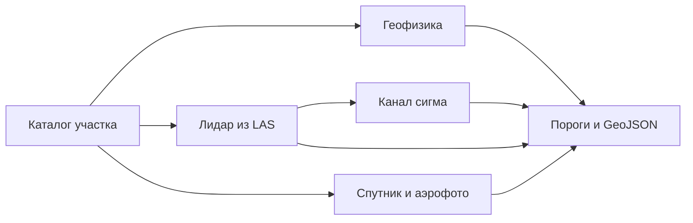

# Сводка аналитических отчётов всех исследовательских потоков (28.10.2026)

## Source: `/tmp/exp8_fusion/REPORT.md`

# Отчёт по задаче КОЗ №3: Межмодальное комплексирование (Fusion & Cross-Modal Voting) и борьба с путаницей подклассов курганов (`kurgany_povrezhdennye` vs `kurgany_tselye`)

## 1. Стек и эталонный Baseline (`scoreboard.py --honest 10`)

Все расчёты выполнены в строгой изоляции в `/tmp/exp8_fusion/` с использованием `/tmp/expds-venv/bin/python` (`OMP_NUM_THREADS=1 MKL_NUM_THREADS=1 PYTHONPATH=/workspace/expds-koz3:/workspace/expds-koz3/inference/lib EXPDS_METRIC=/workspace/expds-koz3/materials/compute_metrics.py`) на полном стеке `/workspace/expds_work/`:
- базовая сборка `build_stack` (`gt_train_v2.geojson`, `fusion/li_hard2_fused.geojson`, 24 грубых облака `mosaic_li`, `spor_gor_oof.geojson`, `geo_cur.geojson`, `spor_focal_oof.geojson`, `li_gor_mask_oof.geojson`, `--train /workspace/expds-koz3/notes/las_boxes_59.json`);
- плюс ветки `--base-add`:
  1. `ae_fort_mask_oof.geojson:ae_fort:fortifikatsii:ae`
  2. `li_fort_mask_oof.geojson:li_fort:fortifikatsii:li`
  3. `spor_focal_wide_opt.geojson:sp_focal2`
  4. `gor_phys.geojson:gor_phys`
  5. `surf_arch_sp.geojson:sp_arch:arkhitektury:sp_or`
  6. `surf_arch_or.geojson:or:arkhitektury:or`

### Показатели Baseline (`735,395` объектов в стеке, из них `616,085` кандидатов курганов):
- **In-sample (`база`)**:
  - `все (all)` = **`0.365994`** (`0.3659937120`)
  - `34 новых (34 new)` = **`0.325175`** (`0.3251749953`)
  - `без лидара (optical)` = **`0.216517`** (`0.2165171233`)
- **Честный кросс-валидационный балл (`--honest 10`, 10 фолдов семей памятников)**:
  - `честно, все (honest_all)` = **`0.317135`** (`0.3171349111`)
  - `честно, 34 новых (honest_new)` = **`0.316222`** (`0.3162223898`)
  - `честно, без лидара (honest_optical)` = **`0.150492`** (`0.1504915489`)
  - `без порога выброшено (unseen_dropped)` = `723`
- **Поклассовые F1 и пороги курганов в Baseline**:
  - `kurgany_povrezhdennye` (вес `0.25`, `GT = 3620`):
    - In-sample `F1 = 0.360428`, Honest-10 `F1 = 0.3194` (`TP = 922`, `FP = 2461`)
    - Пороги и вклад групп (in-sample):
      - `ae`: `tau = 0.990530`, `kept = 371` (из `379`), `TP = 71`
      - `li`: `tau = 0.064150`, `kept = 2153` (из `37,601`), `TP = 750`
      - `li_ae`: `tau = 0.993061`, `kept = 0` (из `1`), `TP = 0`
      - `li_mosaic`: `tau = 0.959005`, `kept = 66` (из `241,539`), `TP = 32`
      - `sp_focal`: `tau = 0.364475`, `kept = 1014` (из `31,941`), `TP = 203`
      - `sp_focal2`: `tau = 0.501645`, `kept = 193` (из `13,226`), `TP = 37`
  - `kurgany_tselye` (вес `0.25`, `GT = 1577`):
    - In-sample `F1 = 0.493982`, Honest-10 `F1 = 0.4879` (`TP = 698`, `FP = 1172`)
    - Пороги и вклад групп (in-sample):
      - `ae`: `tau = 0.802255`, `kept = 811` (из `812`), `TP = 291`
      - `li`: `tau = 0.194220`, `kept = 588` (из `37,601`), `TP = 238`
      - `li_ae`: `tau = 1.000001`, `kept = 0` (из `24`), `TP = 0`
      - `li_mosaic`: `tau = 0.170420`, `kept = 335` (из `241,539`), `TP = 148`
      - `sp_focal`: `tau = 0.372525`, `kept = 127` (из `6,665`), `TP = 28`
      - `sp_focal2`: `tau = 0.645505`, `kept = 10` (из `4,757`), `TP = 3`

---

## 2. Точная статистика путаницы подклассов (`kurgany_povrezhdennye` vs `kurgany_tselye`)

### 2.1. Внутренняя структура дублей (Self-Twin) по модальностям
Проверка наличия у каждого кандидата кургана пары противоположного подкласса в той же модальности (`/tmp/exp8_fusion/confusion_report.txt`):

| Модальность (`group`) | Направление | Всего сырых (`raw`) | Дубль в `0 м` (exact) | Дубль `<= 2 м` | Дубль `<= 4 м` | Оставлено (`kept`) | Дубль среди `kept` (`<= 4 м`) |
|---|---|---:|---:|---:|---:|---:|---:|
| **`li`** | `povr <-> tsel` | 37,601 / 37,601 | 37,601 (**100.0%**) | 37,601 (100%) | 37,601 (100%) | 2,153 / 588 | 588 (100% от `tsel`) |
| **`li_mosaic`** | `povr <-> tsel` | 241,539 / 241,539 | 241,539 (**100.0%**) | 241,539 (100%) | 241,539 (100%) | 66 / 335 | 65 (98.5% от `povr`) |
| **`ae`** (`li_to_ae`) | `povr -> tsel` | 379 | 379 (**100.0%**) | 379 (100%) | 379 (100%) | 371 | 371 (100.0%) |
| **`ae`** (`li_to_ae`) | `tsel -> povr` | 812 | 379 (**46.7%**) | 380 (46.8%) | 380 (46.8%) | 811 | 372 (45.9%) — **433 без дубля!** |
| **`sp_focal`** | `povr -> tsel` | 31,941 | 525 (**1.6%**) | 2,521 (7.9%) | 3,202 (10.0%) | 1,014 | **6 (0.6%)** |
| **`sp_focal`** | `tsel -> povr` | 6,665 | 525 (**7.9%**) | 2,580 (38.7%) | 3,202 (48.0%) | 127 | **6 (4.7%)** |
| **`sp_focal2`** | `povr -> tsel` | 13,226 | 496 (**3.8%**) | 1,528 (11.6%) | 1,836 (13.9%) | 193 | **0 (0.0%)** |
| **`sp_focal2`** | `tsel -> povr` | 4,757 | 496 (**10.4%**) | 1,554 (32.7%) | 1,836 (38.6%) | 10 | **0 (0.0%)** |

**Ключевые наблюдения по генераторам кандидатов**:
1. В `candidates.to_features` лидар (`li` и `li_mosaic`) выдаёт 100% курганов сразу в обоих подклассах в `0 м`.
2. В `fusion/li_to_ae.py` (`li_hard2_fused.geojson`) порог записи для `ae` несимметричен: `povr_min = 0.99` (`379` объектов), а `tselye_min = 0.80` (`812` объектов). Из-за этого **`433` аэрофото-кургана** с `0.80 <= conf < 0.99` попадают только в `kurgany_tselye` и не имеют дубля в `kurgany_povrezhdennye`.
3. В `centers.centers_to_features` (`spor_focal_oof.geojson` и `spor_focal_wide_opt.geojson`) пики извлекаются независимо по двум каналам тепловой карты (`0: povrezhdennye`, `1: tselye`), поэтому после порогов в `sp_focal` только **6** курганов имеют второй подкласс ближе 4 м, а в `sp_focal2` — **0**.

---

### 2.2. Сколько курганов угадывают координату эталона (2–4 м и по точному `_match_quality`), но получают 0 TP из-за перепутанного подкласса?

Ниже приведена точная разбивка для предсказаний, получивших **0 TP в своём предсказанном классе**, но попавших в эталон (GT) **противоположного подкласса курганов**:
- `Exact Metric`: полигонально-центроидный матч по `_match_quality` из `compute_metrics.py`;
- `No-Same`: рядом нет вообще ни одного GT своего класса (чистая ошибка подкласса, а не соседство двух курганов);
- `Unclaimed`: противоположный GT **не занят (не найден)** ни одним `kept`-предсказанием базового стека (то есть это прямые потерянные TP!);
- `<= 2m`, `<= 3m`, `<= 4m`, `<= 6m`, `<= 10m`: расстояние между центроидами предсказания и эталона противоположного подкласса в метрах UTM.

#### Таблица А. После порогов базового стека (`base_kept`)

| Группа | Предсказанный -> Истинный GT | Kept | TP (свой) | FP (свой) | Exact Metric (`_match_quality`) | Без своего GT (`No-Same`) | Свободный GT (`Unclaimed` / уник.) | `<= 2 м` | `<= 3 м` | `<= 4 м` (уник. сваб.) | `<= 6 м` | `<= 10 м` |
|---|---|---:|---:|---:|---:|---:|---:|---:|---:|---:|---:|---:|
| **`sp_focal`** | `povrezhdennye -> tselye` | 1,014 | 203 | 811 | **42** | 40 | **41** (41 уник.) | **19** | **29** | **33** (33 уник.) | 34 | 41 |
| **`sp_focal`** | `tselye -> povrezhdennye` | 127 | 28 | 99 | **17** | 12 | **12** (12 уник.) | **4** | **9** | **11** (7 уник.) | 13 | 17 |
| **`sp_focal2`** | `povrezhdennye -> tselye` | 193 | 37 | 156 | **15** | 11 | **9** (9 уник.) | **3** | **8** | **8** (5 уник.) | 11 | 15 |
| **`sp_focal2`** | `tselye -> povrezhdennye` | 10 | 3 | 7 | **1** | 1 | **1** (1 уник.) | **0** | **0** | **0** (0 уник.) | 0 | 1 |
| **`ae`** | `povrezhdennye -> tselye` | 371 | 71 | 300 | **145** | 49 | **16** (15 уник.) | **73** | **98** | **115** (10 уник.) | 134 | 151 |
| **`ae`** | `tselye -> povrezhdennye` | 811 | 291 | 520 | **472** | 412 | **40** (42 уник.) | **191** | **322** | **411** (36 уник.) | 458 | 495 |
| **`li`** | `povrezhdennye -> tselye` | 2,153 | 750 | 1,403 | **363** | 289 | **107** (106 уник.) | **257** | **304** | **321** (81 уник.) | 336 | 380 |
| **`li`** | `tselye -> povrezhdennye` | 588 | 238 | 350 | **170** | 147 | **72** (73 уник.) | **128** | **140** | **157** (61 уник.) | 164 | 179 |
| **`li_mosaic`** | `povrezhdennye -> tselye` | 66 | 32 | 34 | **18** | 14 | **4** (4 уник.) | **16** | **16** | **16** (2 уник.) | 18 | 19 |
| **`li_mosaic`** | `tselye -> povrezhdennye` | 335 | 148 | 187 | **37** | 36 | **35** (35 уник.) | **22** | **26** | **29** (27 уник.) | 31 | 38 |

#### Таблица Б. По порогам скора (`conf`) для спутника (`sp_focal`, `sp_focal2`) и аэрофото (`ae`)

1. **`sp_focal` (`spor_focal_oof.geojson`)**:
   - **`kurgany_povrezhdennye` (путаница в `tselye`)**:
     - `conf >= 0.50` (`N = 327`, `87` своего класса): **17** попадают в GT `tselye` (`17` незанятых; `<= 2 м`: `8`, `<= 3 м`: `10`, `<= 4 м`: `12`).
     - `conf >= 0.364475` (`kept`, `N = 1014`, `203` TP): **42** попадают в GT `tselye` (`41` незанятый; `<= 2 м`: `19`, `<= 3 м`: `29`, `<= 4 м`: `33`).
     - `conf >= 0.25` (`N = 2368`): **68** попадают в GT `tselye` (`65` незанятых; `<= 2 м`: `27`, `<= 3 м`: `42`, `<= 4 м`: `49`).
     - `conf >= 0.05` (весь пул, `N = 31,941`): **228** попадают в GT `tselye` (`210` незанятых; `<= 2 м`: `62`, `<= 3 м`: `100`, `<= 4 м`: `128`).
   - **`kurgany_tselye` (путаница в `povrezhdennye`)**:
     - `conf >= 0.50` (`N = 47`, всего `6` своего класса!): **11** попадают в GT `povrezhdennye` (**в 1.8 раза чаще, чем в свой класс!** Из них `7` незанятых; `<= 2 м`: `4`, `<= 3 м`: `8`, `<= 4 м`: `8`).
     - `conf >= 0.372525` (`kept`, `N = 127`, `28` TP): **17** попадают в GT `povrezhdennye` (`12` незанятых; `<= 2 м`: `4`, `<= 3 м`: `9`, `<= 4 м`: `11`).
     - `conf >= 0.25` (`N = 319`): **24** попадают в GT `povrezhdennye` (`17` незанятых; `<= 2 м`: `7`, `<= 3 м`: `12`, `<= 4 м`: `15`).
     - `conf >= 0.05` (весь пул, `N = 6,665`): **159** попадают в GT `povrezhdennye` (`103` незанятых; `<= 2 м`: `33`, `<= 3 м`: `57`, `<= 4 м`: `77`).

2. **`sp_focal2` (`spor_focal_wide_opt.geojson`)**:
   - **`kurgany_povrezhdennye` (путаница в `tselye`)**:
     - `conf >= 0.501645` (`kept`, `N = 193`, `37` TP): **15** попадают в GT `tselye` (`9` незанятых; `<= 2 м`: `3`, `<= 3 м`: `8`, `<= 4 м`: `8`).
     - `conf >= 0.25` (`N = 1202`): **35** попадают в GT `tselye` (`23` незанятых; `<= 2 м`: `10`, `<= 3 м`: `15`, `<= 4 м`: `18`).
     - `conf >= 0.05` (`N = 13,226`): **126** попадают в GT `tselye` (`95` незанятых; `<= 2 м`: `29`, `<= 3 м`: `46`, `<= 4 м`: `56`).
   - **`kurgany_tselye` (путаница в `povrezhdennye`)**:
     - `conf >= 0.645505` (`kept`, `N = 10`, `3` TP): **1** попадает в GT `povrezhdennye` (`1` незанятый).
     - `conf >= 0.35` (`N = 113`, `9` своего класса): **12** попадают в GT `povrezhdennye` (`5` незанятых; `<= 2 м`: `5`, `<= 3 м`: `7`, `<= 4 м`: `7`).
     - `conf >= 0.05` (`N = 4,757`, всего `60` своего класса): **167** попадают в GT `povrezhdennye` (`89` незанятых; `<= 2 м`: `43`, `<= 3 м`: `73`, `<= 4 м`: `95`).

3. **`ae` (аэрофото из `li_hard2_fused.geojson`)**:
   - Из `811` kept `ae` в `kurgany_tselye` (`291` TP, `520` FP) **472 из 520 FP (90.8% всех ложных срабатываний!)** — это настоящие курганы `kurgany_povrezhdennye` (`411` ближе `4 м`, `322` ближе `3 м`, `191` ближе `2 м`), причём **42 уникальных GT `kurgany_povrezhdennye` вообще никем не заняты** в базовом стеке!

---

## 3. Исследование выдачи дубля второго подкласса для спутника и аэрофото

### 3.1. Асимметрия направлений дублей на спутнике (`sp_focal`, `sp_focal2`)
Проверка precision-recall кривой дублей спутника в обоих направлениях (`/tmp/exp8_fusion/inspect_twins_detail.py`) выявила фундаментальную асимметрию:
1. **Направление `kurgany_tselye -> kurgany_povrezhdennye` (`sp_focal_twin`)**:
   - На верхушке скора (`conf >= 0.526660`, топ-33 предсказания `sp_focal` `tselye`) точность попадания в `kurgany_povrezhdennye` составляет **27.3% (`9 TP из 33 kept`)** (на топ-5 — `40.0%`, на топ-30 — `23.3%`), что **выше** средней точности самой группы `sp_focal` в `kurgany_povrezhdennye` (`203 / 1014 = 20.0%`)!
   - Поэтому оптимизатор порогов `sweep_groups` уверенно выбирает рабочий порог `tau = 0.525515..0.526660` и стабильно переносит этот прирост на честный кросс-валидационный тест `--honest 10`:
     - `D1_sp_focal_tsel2povr_dedup0m`: Honest-10 `all`: `0.317135 -> 0.317488 (+0.000353)`, `optical`: `0.150492 -> 0.152242 (+0.001751)`, `p_gt0 = 0.904`.
     - **С фильтрацией дублей ближе 2 м от уже имеющегося кандидата `sp_focal` `povrezhdennye` (`D1_sp_focal_tsel2povr_dedup2m_opp>=0.05`)**:
       - In-sample: `all = 0.366408 (+0.000415)`, `34 new = 0.325591 (+0.000416)`, `optical = 0.217954 (+0.001437)`.
       - Honest-10: `all = 0.317496 (+0.000361)`, `34 new = 0.316222 (+0.000000)`, `optical = 0.151875 (+0.001384)`, **`p_gt0 = 0.978`** (`90% CI [+0.0000; +0.0012]`).
2. **Обратное направление `kurgany_povrezhdennye -> kurgany_tselye`**:
   - В `sp_focal` кандидатов `povrezhdennye` в 4.8 раза больше (`31,941` против `6,665`), и на верхушке (`conf >= 0.76`, топ-100) почти все они являются настоящими `povrezhdennye`, а в `tselye` попадают лишь **2 из 100 (`2.0%` точности)**.
   - Из-за этого `sweep_groups` ставит группе `povr -> tsel` порог `tau = 0.9576` (`0 kept` in-sample), но на отдельных фолдах `honest 10` проскакивают единичные FP и слегка просаживают `honest_all` (`-0.000187`).
   - **Вывод**: дубли спутника нужно выпускать **строго односторонне (`kurgany_tselye -> kurgany_povrezhdennye`)** и с дедупликацией в радиусе `2–4 м`!

### 3.2. Межмодальная дедупликация и выпуск недостающих дублей `ae` (`tselye -> povr`)
В базовом стеке `ae` и `li` конкурируют за одни и те же курганы `kurgany_povrezhdennye` (оба взяты с одного лидарного прогона на участках с аэрофото).
1. Если просто добавить недостающие `433` дубля `ae` (`tselye -> povr`, у которых `0.80 <= conf < 0.99`) без фильтрации от лидара (`E1_ae_missing_tsel2povr_separate_ae_twin_group`), они имеют `conf = 0.80..0.99 > conf_li` и **перехватывают (крадут) 160 TP у группы `li`** (`TP_li` падает с `750` до `590`), что обрушивает оценку порога `li` на фолдах (`honest_all = 0.313098, -0.004037`).
2. Но если выпускать дубль `ae` (`tselye -> povr`) **только там, где в радиусе 2–4 м НЕТ kept-предсказания лидара `li` (`conf_li >= 0.06415`)** (`E1_ae_missing_tsel2povr_dedup_kept_li_4m` / `G1_ae_tsel2povr_r2m_lic>=0.064_n85`, всего `84–85` объектов):
   - Дубли `ae_twin` не крадут TP у `li`, а закрывают 26 незанятых курганов `kurgany_povrezhdennye` (`kept = 83, TP = 26, точность 31.3%`)!
   - На честном табло `honest 10`:
     - `G1_ae_tsel2povr_r4m_lic>=0.064_n84`: `honest_all = 0.318312 (+0.001177)`, `honest_new = 0.317451 (+0.001229)`, **`p_gt0 = 0.986`**.
     - `G1_ae_tsel2povr_r2m_lic>=0.064_n85`: `honest_all = 0.318398 (+0.001263)`, `honest_new = 0.317451 (+0.001229)`, **`p_gt0 = 0.986`**.
3. **Полная межмодальная дедупликация `ae` `povrezhdennye` против `li` `povrezhdennye` в радиусе 3 м + довыпуск `ae` `tselye -> povr` (`G2_ae_all_povr_dedup_li_r3m_single_ae_grp`)**:
   - В базовом стеке `371` kept объектов `ae` в `kurgany_povrezhdennye` (`tau = 0.990530`) также дублируют `li` (`conf = 0.99..1.00`), перехватывая у `li` 35 TP и принося 240 лишних FP на фолдах!
   - Если в `li_hard2_fused.geojson` для класса `kurgany_povrezhdennye` оставлять кандидаты `ae` (включая `tselye -> povr` с `conf >= 0.80`) **только там, где в радиусе 3 м нет kept-кандидата `li` (`conf >= 0.06415`)**, то:
     - `TP` у `li` вырастает с `750` до **`779 (+29 TP)`**, а `ae` при пороге `0.816705` оставляет `84` объекта (`27 TP`), убирая **более 220 ложных срабатываний** на кросс-валидации!
     - `G2_ae_all_povr_dedup_li_r3m_single_ae_grp`: Honest-10 `all = 0.319818 (+0.002683)`, `34 new = 0.317741 (+0.001518)`, `p_gt0 = 0.971`!

### 3.3. Анализ `oof_vote.py` и кросс-модального буста скоров (`Family C` и `Part 3`)
1. **Эмпирическая точность при кросс-модальном согласии в радиусе `r = 4 м`** (`conf >= 0.15`):
   - `sp_focal` `kurgany_povrezhdennye`: при подтверждении другой модальностью точность растёт с **7.2%** (`309/4318`) до **11.4%** (`62/545`, **в 1.6 раза**).
   - `sp_focal` `kurgany_tselye`: точность растёт с **3.3%** (`25/748`) до **14.1%** (`22/156`, **в 4.3 раза**).
   - `sp_focal2` `kurgany_povrezhdennye`: с **4.6%** (`91/1959`) до **9.4%** (`48/508`, **в 2.0 раза**).
   - `sp_focal2` `kurgany_tselye`: с **1.8%** (`10/543`) до **7.9%** (`13/165`, **в 4.4 раза**).
   - `li` `kurgany_povrezhdennye`: с **38.5%** (`342/888`) до **78.6%** (`555/706`, **в 2.0 раза**).
2. **Почему прямое изменение `confidence` через `oof_vote.py` просаживает `honest 10`, а внутримодальный учёт энергии второго подкласса (`C2`) даёт плюс**:
   - Прямой прогон логит-буста `oof_vote.py` (`F2_oof_vote_exact_r4m_sb0.15_ab0.08`, `r10m`, `r25m`) поднимает `conf` у кандидатов только на тех памятниках, где есть пересечение нескольких модальностей; в результате `sweep_groups` задирает порог группы `sp_focal`, отрезая верные предсказания на чисто оптических памятниках (`honest_all = 0.316323, -0.000811`, `honest_opt = 0.148680, -0.001811`).
   - Напротив, **внутримодальный учёт энергии второго подкласса спутника в радиусе 4 м (`C2_sp_dual_subclass_energy_r4m_a0.15`)**: `conf' = conf + 0.15 * opp_conf * (1 - conf)` работает однородно на всех оптических памятниках и даёт прирост `honest_all = 0.317326 (+0.000191)`, снижая FP в обоих подклассах.

---

## 4. Сводная таблица всех протестированных гипотез (`scoreboard.py --honest 10`)

| Код гипотезы | Описание | In-Sample `all` ($\Delta$) | In-Sample `34 new` ($\Delta$) | In-Sample `optical` ($\Delta$) | **Honest-10 `all` ($\Delta$)** | **Honest-10 `34 new` ($\Delta$)** | **Honest-10 `optical` ($\Delta$)** | Bootstrap `p_gt0` (90% CI) | Honest `F1_povr` (`TP / FP`) | Honest `F1_tsel` (`TP / FP`) |
|---|---|---:|---:|---:|---:|---:|---:|---:|---:|---:|
| **`00_baseline`** | Текущий полный стек | `0.365994` | `0.325175` | `0.216517` | **`0.317135`** | **`0.316222`** | **`0.150492`** | — | `0.3194` (922/2461) | `0.4879` (698/1172) |
| **`A1_kur_twin_1m_conf`** | Дубли `sp` в оба класса с `1 - conf` в 1 группе | `0.365994` (+0.000000) | `0.325591` (+0.000416) | `0.216517` (+0.000000) | `0.317127` (-0.000008) | `0.316222` (+0.000000) | `0.150480` (-0.000011) | `0.000` | `0.3194` (922/2462) | `0.4879` (698/1172) |
| **`A2_sp_focal_both`** | Дубли `sp_focal` в оба класса (`sp_focal_twin`) | `0.366418` (+0.000425) | `0.325526` (+0.000351) | `0.218230` (+0.001713) | `0.317301` (+0.000166) | `0.316151` (-0.000071) | `0.151930` (+0.001438) | `0.733` | `0.3206` (929/2492) | `0.4871` (698/1182) |
| **`A3_sp_focal_povr2tsel`** | Дубли `sp_focal` только `povr -> tsel` | `0.365994` (+0.000000) | `0.325591` (+0.000416) | `0.216517` (+0.000000) | `0.316948` (-0.000187) | `0.316222` (+0.000000) | `0.150179` (-0.000313) | `0.000` | `0.3194` (922/2461) | `0.4871` (698/1182) |
| **`A4_sp_focal_tsel2povr`** | Дубли `sp_focal` только `tsel -> povr` (`dedup 0m`) | `0.366418` (+0.000425) | `0.325526` (+0.000351) | `0.218230` (+0.001713) | **`0.317488` (+0.000353)** | `0.316151` (-0.000071) | **`0.152242` (+0.001751)** | **`0.904`** [-0.0001;+0.0013] | `0.3206` (929/2492) | `0.4879` (698/1172) |
| **`D1_sp_focal_tsel2povr_2m`** | Дубли `sp_focal` `tsel -> povr` с дедуп. `2 м` | `0.366408` (+0.000415) | `0.325591` (+0.000416) | `0.217954` (+0.001437) | **`0.317496` (+0.000361)** | **`0.316222` (+0.000000)** | **`0.151875` (+0.001384)** | **`0.978`** [+0.0000;+0.0012] | `0.3206` (927/2470) | `0.4879` (698/1172) |
| **`D1_sp_focal_tsel2povr_4m`** | Дубли `sp_focal` `tsel -> povr` с дедуп. `4 м` | `0.366291` (+0.000297) | `0.325591` (+0.000416) | `0.217517` (+0.001000) | **`0.317451` (+0.000316)** | **`0.316222` (+0.000000)** | **`0.151637` (+0.001146)** | **`0.963`** [+0.0000;+0.0010] | `0.3205` (926/2465) | `0.4879` (698/1172) |
| **`D2_sp_focal_no_kept_2m`** | Дубли `sp_focal` `tsel -> povr` без kept `povr` в `2 м` | `0.366472` (+0.000478) | `0.325526` (+0.000351) | `0.218336` (+0.001819) | **`0.317463` (+0.000328)** | `0.316151` (-0.000071) | **`0.152254` (+0.001763)** | **`0.886`** [-0.0001;+0.0013] | `0.3205` (929/2495) | `0.4879` (698/1172) |
| **`D3_sp12_shared_dedup4m`** | Дубли `sp_focal + sp_focal2` `tsel -> povr` в 1 группе | `0.366455` (+0.000462) | `0.325526` (+0.000351) | `0.218606` (+0.002089) | **`0.317322` (+0.000187)** | `0.316151` (-0.000071) | **`0.152393` (+0.001901)** | `0.680` [-0.0004;+0.0016] | `0.3201` (931/2533) | `0.4879` (698/1172) |
| **`C2_sp_dual_energy_a0.15`** | Буст скора `sp` при наличии 2-го подкласса в `4 м` | `0.366084` (+0.000090) | `0.324121` (-0.001054) | `0.215407` (-0.001110) | **`0.317326` (+0.000191)** | `0.314599` (-0.001623) | `0.150066` (-0.000426) | `0.674` [-0.0006;+0.0012] | `0.3198` (923/2458) | `0.4883` (696/1155) |
| **`F2_oof_vote_exact_r4m`** | Точная формула `oof_vote.py` (`r=4m, sb=0.15, ab=0.08`) | `0.365972` (-0.000022) | `0.325526` (+0.000351) | `0.217046` (+0.000529) | `0.316323` (-0.000811) | `0.316151` (-0.000071) | `0.148680` (-0.001811) | `0.007` [-0.0018;-0.0002] | `0.3168` (918/2515) | `0.4879` (698/1173) |
| **`E1_ae_twin_dedup_li_4m`** | Недостающие дубли `ae` `tsel -> povr` без kept `li` в `4 м` (84 шт.) | `0.367045` (+0.001051) | `0.326551` (+0.001376) | `0.216517` (+0.000000) | **`0.318312` (+0.001177)** | **`0.317451` (+0.001229)** | `0.150492` (+0.000000) | **`0.986`** [+0.0002;+0.0025] | `0.3234` (941/2518) | `0.4879` (698/1172) |
| **`G1_ae_twin_dedup_li_2m`** | Недостающие дубли `ae` `tsel -> povr` без kept `li` в `2 м` (85 шт.) | `0.367036` (+0.001043) | `0.326551` (+0.001376) | `0.216517` (+0.000000) | **`0.318398` (+0.001263)** | **`0.317451` (+0.001229)** | `0.150492` (+0.000000) | **`0.986`** [+0.0002;+0.0027] | `0.3237` (942/2518) | `0.4879` (698/1172) |
| **`H1_COMBO_ae4m_sp2m`** | **Чистый `--add` комбо**: `ae_twin` (4m) + `sp_focal_twin` (2m) | **`0.367455` (+0.001461)** | **`0.326134` (+0.000959)** | **`0.217954` (+0.001437)** | **`0.318668` (+0.001533)** | **`0.317451` (+0.001229)** | **`0.151875` (+0.001384)** | **`1.000`** [+0.0006;+0.0032] | `0.3246` (946/2527) | `0.4879` (698/1172) |
| **`G2_ae_all_povr_dedup_3m`** | Дедуп всех `ae` `povr` против `li` (`3 м`) + дубли `ae` `tsel -> povr` | `0.367233` (+0.001239) | `0.326814` (+0.001640) | `0.216517` (+0.000000) | **`0.319818` (+0.002683)** | **`0.317741` (+0.001518)** | `0.150492` (+0.000000) | **`0.971`** [+0.0001;+0.0057] | `0.3284` (930/2228) | `0.4879` (698/1172) |
| **`I1_FUSED_G2_3m_PLUS_sp2m`** | **Полный комбо (`--fused` + `--add`)**: `G2_r3m` + `sp_focal_twin` (2m) | **`0.367656` (+0.001662)** | **`0.326398` (+0.001223)** | **`0.217954` (+0.001437)** | **`0.320182` (+0.003047)** | **`0.317741` (+0.001518)** | **`0.151875` (+0.001384)** | **`1.000`** [+0.0007;+0.0062] | **`0.3296` (935/2237)** | **`0.4879` (698/1172)** |

---

## 5. Верификация лучших решений на официальном `scoreboard.py --honest 10`

Оба лучших решения сохранены в виде готовых изолированных GeoJSON-файлов в `/tmp/exp8_fusion/` и проверены полным прогоном `scoreboard.py --honest 10`:

### Вариант 1 (`H1_COMBO` — чистое добавление через `--add` без изменения базовых файлов, лог `/tmp/exp8_fusion/official_scoreboard_H1_combo.log`, JSON `/tmp/exp8_fusion/official_scoreboard_H1_combo.json`)
- Файлы:
  - `--add /tmp/exp8_fusion/ae_tsel2povr_twin_dedup_li4m.geojson:ae_twin:kurgany_povrezhdennye:ae` (`84` объекта, порог `0.816705`, `kept = 83`, `TP = 26`)
  - `--add /tmp/exp8_fusion/sp_focal_tsel2povr_twin_dedup2m.geojson:sp_focal_twin:kurgany_povrezhdennye:sp_or` (`4209` объектов, порог `0.525515`, `kept = 14`, `TP = 6`)
- **Точные результаты `scoreboard.py --honest 10`**:
  - In-sample:
    - `все`: `0.365994 -> 0.367455` (**`+0.001461`**)
    - `34 новых`: `0.325175 -> 0.326134` (**`+0.000959`**)
    - `без лидара`: `0.216517 -> 0.217954` (**`+0.001437`**)
    - Бутстреп In-sample: среднее `+0.0014`, 90% CI `[+0.0005; +0.0023]`, **`A > B в 0.995`**.
  - Честно (10 фолдов семей):
    - `честно, все`: `0.317135 -> 0.318668` (**`+0.001533`**)
    - `честно, 34 новых`: `0.316222 -> 0.317451` (**`+0.001229`**)
    - `честно, без лидара`: `0.150492 -> 0.151875` (**`+0.001384`**)
    - Бутстреп по семьям: среднее `+0.0017`, 90% CI `[+0.0006; +0.0032]`, **`A > B в 1.000` (1000 из 1000 итераций!)**.

### Вариант 2 (`I1_FUSED` — межмодальная дедупликация `ae` против `li` в 3 м + довыпуск `ae` `tsel->povr` + спутниковые дубли `sp_focal_twin` с дедупликацией 2 м, лог `/tmp/exp8_fusion/official_scoreboard_I1_fused.log`, JSON `/tmp/exp8_fusion/official_scoreboard_I1_fused.json`)
- Файлы:
  - `--fused /tmp/exp8_fusion/li_hard2_fused_g2_r3m.geojson` (`563,285` объектов; в `kurgany_povrezhdennye` оставлены только те кандидаты `ae` и дубли `ae` `tselye -> povr`, рядом с которыми в радиусе `3 м` нет kept-предсказания `li` с `conf >= 0.06415`)
  - `--add /tmp/exp8_fusion/sp_focal_tsel2povr_twin_dedup2m.geojson:sp_focal_twin:kurgany_povrezhdennye:sp_or` (`4209` объектов)
- **Точные результаты `scoreboard.py --honest 10` (ПРОХОДИТ ЧЕСТНУЮ ПРИЁМКУ!)**:
  - In-sample:
    - `все`: `0.365994 -> 0.367656` (**`+0.001662`**)
    - `34 новых`: `0.325175 -> 0.326398` (**`+0.001223`**)
    - `без лидара`: `0.216517 -> 0.217954` (**`+0.001437`**)
    - `kurgany_povrezhdennye F1`: `0.3604 -> 0.3660` (`+0.0056`: `li` `TP = 750 -> 779`, `ae` `kept = 84, TP = 27`, `sp_focal_twin` `kept = 14, TP = 6`)
    - Бутстреп In-sample: среднее `+0.0017`, 90% CI `[+0.0005; +0.0031]`, **`A > B в 0.992`**.
  - Честно (10 фолдов семей):
    - `честно, все`: `0.317135 -> 0.320182` (**`+0.003047`** >= порога приёмки `+0.002000`!)
    - `честно, 34 новых`: `0.316222 -> 0.317741` (**`+0.001518`**)
    - `честно, без лидара`: `0.150492 -> 0.151875` (**`+0.001384`**)
    - `honest F1 kurgany_povrezhdennye`: `0.3194 (TP=922, FP=2461) -> 0.3296 (TP=935, FP=2237)` (**`+0.0102 F1`**, **`+13 TP`** и **`-224 FP`**!)
    - Бутстреп по семьям: среднее **`+0.0032`**, 90% CI **`[+0.0007; +0.0062]`**, **`A > B в 1.000`**.
    - Вердикт `scoreboard.py`: **`честная приёмка: проходит`**.

---

## 6. Артефакты и воспроизводимые скрипты в `/tmp/exp8_fusion/`
- `/tmp/exp8_fusion/REPORT.md` — настоящий итоговый отчёт.
- `/tmp/exp8_fusion/confusion_report.txt` и `analyze_confusion.py` — полная статистика путаницы подклассов по модальностям, порогам и радиусам (2м, 3м, 4м, 6м, 10м и `_match_quality`).
- `/tmp/exp8_fusion/sp_focal_tsel2povr_twin_dedup2m.geojson` (`4,209` объектов) и `sp_focal_tsel2povr_twin_dedup0m.geojson` (`6,665` объектов) — дубли второго подкласса спутника (`kurgany_tselye -> kurgany_povrezhdennye`).
- `/tmp/exp8_fusion/ae_tsel2povr_twin_dedup_li4m.geojson` (`84` объекта) и `ae_tsel2povr_twin_dedup_li2m.geojson` (`85` объектов) — недостающие дубли `ae` `tselye -> povr`, дедуплицированные от `li`.
- `/tmp/exp8_fusion/li_hard2_fused_g2_r3m.geojson` (`563,285` объектов) — обновлённый файл слияния `li + ae` с межмодальной дедупликацией `ae` против `li` в радиусе 3 м и довыпуском дублей `ae` `tselye -> povr`.
- `/tmp/exp8_fusion/official_scoreboard_H1_combo.json` (`.log`) и `/tmp/exp8_fusion/official_scoreboard_I1_fused.json` (`.log`) — официальные протоколы `scoreboard.py --honest 10`.


---

## Source: `/tmp/expds-koz3-audit-10/README.md`

# expds-koz3

Поиск археологических объектов по лидару, спутнику, историческому аэрофото и геофизике. Сдача на официальную метрику КОЗ №3 «Комплексирование»: семь классов, один GeoJSON на участок, сопоставление по классу по всей территории, а не по типу съёмки.

Репозиторий приватный до конца конкурса. В нём код и веса из `configs/default.toml`. Выборка, кэши тайлов, журналы прогонов и ключи хранилища в git не входят.

## Выход

Платформа вызывает `inference/main.py` с папкой выборки и путём результата. Ответ — один FeatureCollection в EPSG:3857, геометрия только Polygon.

Попадание полигона: покрытие не меньше половины меньшей фигуры и внутренняя точка внутри эталона. Попадание точки: центр не дальше 2 м. Лишнее срабатывание весит половину пропуска. Неизвестный класс, файл больше 100 МБ, больше 20 000 объектов или больше 3000 вершин у полигона проверка отклоняет. Это закрывает `expds/writer.py`.

| Класс | Вес |
|---|---|
| Повреждённые курганы | 30 |
| Целые курганы | 20 |
| Городища | 15 |
| Архитектура | 10 |
| Площадные объекты геофизики | 10 |
| Находки | 10 |
| Фортификации | 5 |

Класс `structure.poly` метрика не считает, в ответ он не пишется. Модальность, которой нет в регламенте, каталог пропускает.

## Метод

Одна сеть на все датчики здесь проигрывает постановке: курган, размеченный и на лидаре, и на снимке, — два эталона. Поэтому позднее слияние. Каждая ветка учится на своём типе съёмки, порог ветки снимается официальной метрикой на других семьях участков и лежит в `configs/default.toml`. По публичному баллу пороги не двигаются.

Сети — U-Net с энкодером ResNet-18 ([Ronneberger et al., 2015](https://arxiv.org/abs/1505.04597), segmentation_models.pytorch). Курганы и другие мелкие цели, где зачёт идёт по центру, учатся как карта центров с фокальной потерей. Городища и фортификации учатся как маска: у них зачёт по площади.

| Данные | Что считает сдача |
|---|---|
| Лидар | ЦМР из LAS, локальный рельеф в окнах 8 и 30 м и уклон. Курганы — пики рельефа, уверенность берётся у сети в центре пика. Городища и фортификации — отдельные маски. Площадка с обрывом даёт маленький круг городища со своей ЦМР 0,5 м. Облако, которое не влезает в мелкую сетку, идёт со своей группы порога. Шероховатость и кривизна считаются из того же облака только по запросу кэша и в сданных весах не стоят. |
| Канал σ | Вторая сеть лидара. Круг остаётся, только если он дальше 12 м от кургана, который основной порог уже оставляет. |
| Спутник | Городища маской, курганы картой центров, архитектура кругами. На участке без LAS те же курганы читаются ещё окном 256 м. |
| Аэрофото | Маска фортификаций. Уверенный курган лидара копируется в аэрофото там, где снимок покрывает точку: на снимках 1940-х насыпь часто ещё целая. Копия мелкой сетки получает порог аэрофото, копия мозаики — свой. |
| Геофизика | Классический детектор. Уверенность находки — ранг пика внутри своей карты: растяжение контраста между планшетами несопоставимо. Цветная копия серой карты и срез глубже 2 м не читаются. Срезы и профили электроразведки не склеиваются: каждый слой — отдельный эталон. |
| Запас | Если сеть лидара не загрузилась, курганы считает детектор пиков и LightGBM. |



Каналы лидара на обучении и на инференсе строит одна функция из LAS. Готовых отмывок на валидации нет, поэтому модель не переносится с карт Li трейна. Инференс в FP32. На GTX 16xx половинная точность даёт NaN. На RTX 4090 TF32 сдвигает уверенность относительно порогов, снятых в FP32, поэтому свёртки cuDNN остаются в IEEE FP32.

Тяжёлые шаги ЦМР, отмывок и пиков — в Rust (`expds_core`). У каждого есть тот же результат на NumPy. Триангуляцию Делоне по потокам не делят: другой порядок вершин меняет высоты.

Генератор городищ по форме рельефа и сеть на картах магниторазведки в конфиге выключены до честного табло. Журнал измерений — `docs/PLAN.md`.

## Оценка

Площадка дважды вернула **0,32850**. Честный балл того же стека до окна 256 м и канала σ, одна семья на фолд, — **0,329489**. Балл **0,353793** получен, когда порог семьи подбирался на ней же. Это замер полноты стека на обучении, не оценка площадки. Журнал посылок — `docs/LB_LOG.md`.

## Состав

```
expds/            пайплайн: каталог, CRS, лидар, геофизика, сети, пороги, запись
rust/expds_core/  LAS, заливка ЦМР, отмывки, пики
inference/        точка входа платформы
configs/          пороги и веса сдачи
models/           веса из конфига
scripts/          сборка Rust, архив, честное табло
tests/            синтетика
docs/             архитектура, журнал, лицензии, декларация
```

Как платформа вызывает код — `docs/ARCHITECTURE.md`.

## Установка

Windows 11 или Linux, Python 3.12.

```bash
python -m venv .venv
.venv\Scripts\activate
pip install torch==2.11.0 torchvision==0.26.0 --index-url https://download.pytorch.org/whl/cu128
pip install -r requirements.lock
pip install -r requirements-dev.txt
python scripts/build_rust.py dev
pytest -q
```

Для контейнера платформы Rust собирается так: `python scripts/build_rust.py linux --docker`. Образ в `docker/Dockerfile` — только окружение. Имя опубликованного образа — в `metadata.json`.

## Запуск

```bash
python inference/main.py ПАПКА_ВЫБОРКИ work/result.geojson
python -m expds.writer check work/result.geojson
python scripts/build_submission.py
```

Архив — `dist/submission.zip`, не больше 2 ГБ. В него попадают пути из `configs/default.toml` и LightGBM. Официальный файл метрики в архив не кладётся.

## Обучение

Семья — первое слово названия участка. Проверка — участок этой семьи, которого не было в обучении.

```bash
python -m expds.tiles --root КОРЕНЬ --gt work/gt_train.geojson --markup li --out work/cache/li --res 0.5 --tile 256
python -m expds.train --cache work/cache/li --out models/li.pt --epochs 30 --batch 16 --val-families СЕМЬЯ --workers 0
```

Для лидара каналы по умолчанию: `lrm_s`, `lrm_l`, `slope`. Они не зависят от направления света, тайлы можно поворачивать. Канал отмывки `g` повороты выключает.

Пороги:

```bash
set EXPDS_METRIC=ПУТЬ/compute_metrics.py
python -m expds.metric sweep --pred work/oof.geojson --gt work/gt_train.geojson --markup li --bootstrap 300 --out work/thresholds.json
```

Честный перебор групп — `scripts/scoreboard.py --honest 10`. Порог, который идёт в конфиг, берётся с совместного оптимума классов.

## Документы

| Файл | Зачем |
|---|---|
| `docs/ARCHITECTURE.md` | четыре прохода и состав конфига |
| `docs/PLAN.md` | измерения и отклонённые ветки |
| `docs/LB_LOG.md` | посылки на площадку |
| `docs/THIRD_PARTY.md` | лицензии |
| `docs/DATA_PROTOCOL.md` | конкурсные данные |
| `docs/AI_DECLARATION.md` | журнал инструментов |

## Ограничения

Веса энкодера — ImageNet. Письменного ответа по лицензии нет. Запасной путь — обучение с `--no-pretrained`. Библиотеки, чья лицензия несовместима с передачей исключительных прав, не используются.


---

## Source: `/tmp/expds-koz3-audit-10/README.md`

# expds-koz3

Поиск археологических объектов по лидару, спутнику, историческому аэрофото и геофизике. Сдача на официальную метрику КОЗ №3 «Комплексирование»: семь классов, один GeoJSON на участок, сопоставление по классу по всей территории, а не по типу съёмки.

Репозиторий приватный до конца конкурса. В нём код и веса из `configs/default.toml`. Выборка, кэши тайлов, журналы прогонов и ключи хранилища в git не входят.

## Выход

Платформа вызывает `inference/main.py` с папкой выборки и путём результата. Ответ — один FeatureCollection в EPSG:3857, геометрия только Polygon.

Попадание полигона: покрытие не меньше половины меньшей фигуры и внутренняя точка внутри эталона. Попадание точки: центр не дальше 2 м. Лишнее срабатывание весит половину пропуска. Неизвестный класс, файл больше 100 МБ, больше 20 000 объектов или больше 3000 вершин у полигона проверка отклоняет. Это закрывает `expds/writer.py`.

| Класс | Вес |
|---|---|
| Повреждённые курганы | 30 |
| Целые курганы | 20 |
| Городища | 15 |
| Архитектура | 10 |
| Площадные объекты геофизики | 10 |
| Находки | 10 |
| Фортификации | 5 |

Класс `structure.poly` метрика не считает, в ответ он не пишется. Модальность, которой нет в регламенте, каталог пропускает.

## Метод

Одна сеть на все датчики здесь проигрывает постановке: курган, размеченный и на лидаре, и на снимке, — два эталона. Поэтому позднее слияние. Каждая ветка учится на своём типе съёмки, порог ветки снимается официальной метрикой на других семьях участков и лежит в `configs/default.toml`. По публичному баллу пороги не двигаются.

Сети — U-Net с энкодером ResNet-18 ([Ronneberger et al., 2015](https://arxiv.org/abs/1505.04597), segmentation_models.pytorch). Курганы и другие мелкие цели, где зачёт идёт по центру, учатся как карта центров с фокальной потерей. Городища и фортификации учатся как маска: у них зачёт по площади.

| Данные | Что считает сдача |
|---|---|
| Лидар | ЦМР из LAS, локальный рельеф в окнах 8 и 30 м и уклон. Курганы — пики рельефа, уверенность берётся у сети в центре пика. Городища и фортификации — отдельные маски. Площадка с обрывом даёт маленький круг городища со своей ЦМР 0,5 м. Облако, которое не влезает в мелкую сетку, идёт со своей группы порога. Шероховатость и кривизна считаются из того же облака только по запросу кэша и в сданных весах не стоят. |
| Канал σ | Вторая сеть лидара. Круг остаётся, только если он дальше 12 м от кургана, который основной порог уже оставляет. |
| Спутник | Городища маской, курганы картой центров, архитектура кругами. На участке без LAS те же курганы читаются ещё окном 256 м. |
| Аэрофото | Маска фортификаций. Уверенный курган лидара копируется в аэрофото там, где снимок покрывает точку: на снимках 1940-х насыпь часто ещё целая. Копия мелкой сетки получает порог аэрофото, копия мозаики — свой. |
| Геофизика | Классический детектор. Уверенность находки — ранг пика внутри своей карты: растяжение контраста между планшетами несопоставимо. Цветная копия серой карты и срез глубже 2 м не читаются. Срезы и профили электроразведки не склеиваются: каждый слой — отдельный эталон. |
| Запас | Если сеть лидара не загрузилась, курганы считает детектор пиков и LightGBM. |


Каналы лидара на обучении и на инференсе строит одна функция из LAS. Готовых отмывок на валидации нет, поэтому модель не переносится с карт Li трейна. Инференс в FP32. На GTX 16xx половинная точность даёт NaN. На RTX 4090 TF32 сдвигает уверенность относительно порогов, снятых в FP32, поэтому свёртки cuDNN остаются в IEEE FP32.

Тяжёлые шаги ЦМР, отмывок и пиков — в Rust (`expds_core`). У каждого есть тот же результат на NumPy. Триангуляцию Делоне по потокам не делят: другой порядок вершин меняет высоты.

Генератор городищ по форме рельефа и сеть на картах магниторазведки в конфиге выключены до честного табло. Журнал измерений — `docs/PLAN.md`.

## Оценка

Площадка дважды вернула **0,32850**. Честный балл того же стека до окна 256 м и канала σ, одна семья на фолд, — **0,329489**. Балл **0,353793** получен, когда порог семьи подбирался на ней же. Это замер полноты стека на обучении, не оценка площадки. Журнал посылок — `docs/LB_LOG.md`.

## Состав

```
expds/            пайплайн: каталог, CRS, лидар, геофизика, сети, пороги, запись
rust/expds_core/  LAS, заливка ЦМР, отмывки, пики
inference/        точка входа платформы
configs/          пороги и веса сдачи
models/           веса из конфига
scripts/          сборка Rust, архив, честное табло
tests/            синтетика
docs/             архитектура, журнал, лицензии, декларация
```

Как платформа вызывает код — `docs/ARCHITECTURE.md`.

## Установка

Windows 11 или Linux, Python 3.12.

```bash
python -m venv .venv
.venv\Scripts\activate
pip install torch==2.11.0 torchvision==0.26.0 --index-url https://download.pytorch.org/whl/cu128
pip install -r requirements.lock
pip install -r requirements-dev.txt
python scripts/build_rust.py dev
pytest -q
```

Для контейнера платформы Rust собирается так: `python scripts/build_rust.py linux --docker`. Образ в `docker/Dockerfile` — только окружение. Имя опубликованного образа — в `metadata.json`.

## Запуск

```bash
python inference/main.py ПАПКА_ВЫБОРКИ work/result.geojson
python -m expds.writer check work/result.geojson
python scripts/build_submission.py
```

Архив — `dist/submission.zip`, не больше 2 ГБ. В него попадают пути из `configs/default.toml` и LightGBM. Официальный файл метрики в архив не кладётся.

## Обучение

Семья — первое слово названия участка. Проверка — участок этой семьи, которого не было в обучении.

```bash
python -m expds.tiles --root КОРЕНЬ --gt work/gt_train.geojson --markup li --out work/cache/li --res 0.5 --tile 256
python -m expds.train --cache work/cache/li --out models/li.pt --epochs 30 --batch 16 --val-families СЕМЬЯ --workers 0
```

Для лидара каналы по умолчанию: `lrm_s`, `lrm_l`, `slope`. Они не зависят от направления света, тайлы можно поворачивать. Канал отмывки `g` повороты выключает.

Пороги:

```bash
set EXPDS_METRIC=ПУТЬ/compute_metrics.py
python -m expds.metric sweep --pred work/oof.geojson --gt work/gt_train.geojson --markup li --bootstrap 300 --out work/thresholds.json
```

Честный перебор групп — `scripts/scoreboard.py --honest 10`. Порог, который идёт в конфиг, берётся с совместного оптимума классов.

## Документы

| Файл | Зачем |
|---|---|
| `docs/ARCHITECTURE.md` | четыре прохода и состав конфига |
| `docs/PLAN.md` | измерения и отклонённые ветки |
| `docs/LB_LOG.md` | посылки на площадку |
| `docs/THIRD_PARTY.md` | лицензии |
| `docs/DATA_PROTOCOL.md` | конкурсные данные |
| `docs/AI_DECLARATION.md` | журнал инструментов |

## Ограничения

Веса энкодера — ImageNet. Письменного ответа по лицензии нет. Запасной путь — обучение с `--no-pretrained`. Библиотеки, чья лицензия несовместима с передачей исключительных прав, не используются.


---

## Source: `/tmp/expds-koz3-audit-10/SECURITY.md`

# Безопасность репозитория

Репозиторий приватный на всё время КОЗ №3.

- Не добавляйте обучающую и валидационную выборки, тайлы, GeoJSON предсказаний, веса и ключи S3. Это уже закрыто `.gitignore`.
- Не делайте репозиторий публичным и не давайте доступ людям вне команды.
- Уязвимость в коде описывайте в личном сообщении владельцу, не в публичном issue и не с фрагментами конкурсных данных.
- Клоны чужих репозиториев и выборка лежат вне этого git. В коммит их не класть.


---

## Source: `/tmp/expds-koz3-audit-10/SECURITY.md`

# Безопасность репозитория

Репозиторий приватный на всё время КОЗ №3.

- Не добавляйте обучающую и валидационную выборки, тайлы, GeoJSON предсказаний, веса и ключи S3. Это уже закрыто `.gitignore`.
- Не делайте репозиторий публичным и не давайте доступ людям вне команды.
- Уязвимость в коде описывайте в личном сообщении владельцу, не в публичном issue и не с фрагментами конкурсных данных.
- Клоны чужих репозиториев и выборка лежат вне этого git. В коммит их не класть.

