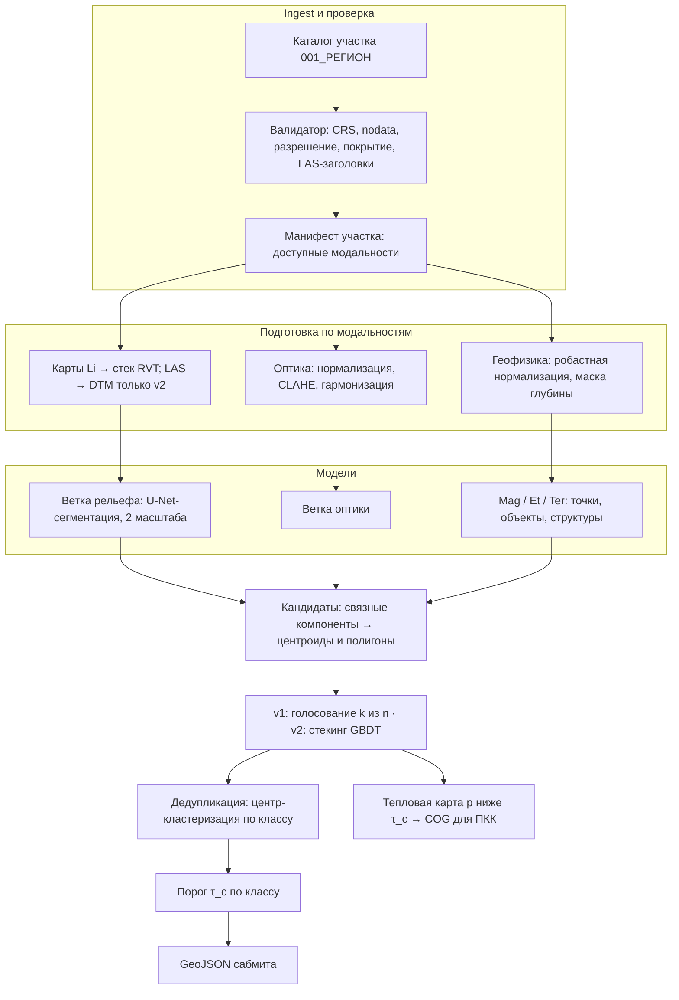
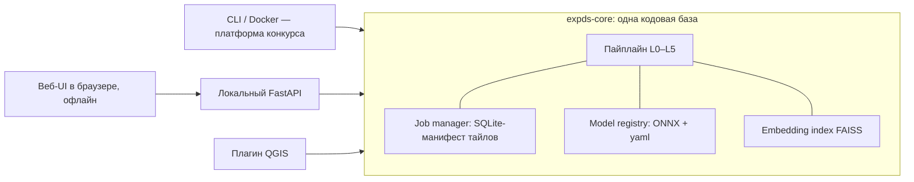

# КОЗ №3 «Комплексирование» — OSINT, SOTA и архитектурный каркас решения

> Конкурс «Экспедиция. Data Science» (UP GREAT / Фонд НТИ). **Версия 2** от 12.10.2026 (день старта квалификации). После ревизии все решения разделены на **v1** (обязательно до финала) и **v2** (только если выиграет в абляции); у каждого утверждения указан статус.
> Основа: материалы консультации №1 по ТР КОЗ №3, публичные страницы конкурса, OSINT по GitHub и литературе.
> Всё, что помечено **[проверить]**, зависит от финального ТР и `compute_metrics.py` — сверить в первый же день.

---

## 0. TL;DR

1. **Публичного кода призёров конкурса нет.** Найдено 2 репозитория участников (каркас команды КОЗ №3 и пайплайн по курганам с прошлого этапа). Есть ещё репозиторий xView2-решения, автор которого, **вероятно**, капитан Family — это вывод по имени, не подтверждённый факт.
2. **Метрика КОЗ №3 — центроидная и recall-ориентированная:** засчитывается попадание центра или частичное перекрытие, контур не влияет, FP стоит ½ FN. Порог выдачи подбирается **по классам на официальной метрике**; p > 1/3 — лишь стартовая точка, верная при линейной цене ошибок.
3. **v1-архитектура:** U-Net-сегментация на модальность → связные компоненты → центроиды и полигоны → голосование «k из n» → дедупликация → пороги по классам. Это обобщение решений Family (голосование 2 из 4), mlart (разделение по физике сигнала) и GigaFlex (специализация по классам).
4. **v2 — только через абляции:** heatmap-голова для компактных классов, стекинг на GBDT, специалисты, SSL, пересчёт DTM из LAS, TensorRT.
5. **Инференс — на готовых картах `Li`.** Фильтрация земли из LAS может съесть бюджет в 30 минут, а разметка, вероятно, делалась по картам.
6. **Финальный рейтинг — только метрика.** До финала ПКК делается как MVP (CLI + плагин QGIS); полная версия — в 30 дней после финала, если команда в топ-2.

### 0.1. Статус утверждений

| Утверждение | Статус | Основание |
|---|---|---|
| Поздний fusion: модель на модальность | подтверждено практикой | все три призёра КОЗ №2 |
| Group k-fold по регионам | стандарт | утечка между соседними тайлами |
| Дедупликация критична | вывод из правил | «один эталон — одно предсказание» |
| Каналы RVT лучше одиночного hillshade | литература | Kokalj & Hesse 2017; бенчмарк Arran |
| Hillshade нельзя поворачивать аугментацией | физика сигнала | меняется видимое направление света |
| Порог p > 1/3 | гипотеза | верно только при линейной цене; формула не раскрыта |
| Heatmap-голова лучше сегментации | гипотеза | у валов и рвов центр плохо определён |
| Пересчёт DTM из LAS даёт прирост | гипотеза, риск по времени | разметка, вероятно, по картам `Li` |
| Стекинг GBDT лучше голосования | гипотеза, риск переобучения | двойной объём обучения, 142 участка геофизики |
| Нейросеть лучше классики для `finds.points` | не проверено | нужен бейзлайн поиска пиков |
| `vdurnov` — капитан Family | вывод по имени | не подтверждено |
| Приёмы Iskatel-gis (Copy-Paste и др.) | не проверено | у репозитория нет опубликованных скоров |
| Литература раздела 2.4 | по памяти | сверить DOI перед цитированием |

---

## 1. Ограничения задачи (из консультации и ТР)

### 1.1. Данные

| Группа | Участков | Слои (папки) | Формат | Классы / разметка |
|---|---|---|---|---|
| ДЗЗ | 880 | `01_La_точки` (LAS), `02_Li_карты`, `03_Ae_аэрофото` (историческая), `04_SpOr_спутник`, `05_Or_ортофото`, `06_разметка` | GeoTIFF, LAS, GeoJSON | курганы целые / повреждённые (7328), городища (1462), фортификация (762), архитектура (666) |
| Геофизика | 142 | `07_MagGr_карты`, `08_EtGr_карты`, `08_EtGr_профили`, `09_TerFl_карты` | GeoTIFF | Mag: `finds.points` r 0,1–1 м, `object.poly` 1–30 м², `structure.poly` 2–400 м² (5134); Et: `object.poly` 0,3–12 м² (1000); Ter: `object.poly` 0,3–10 м², `structure.poly` 1–50 м² (330) |

- Координаты: UTM-зоны по таблице организаторов → все расчёты в метрической CRS участка, экспорт — как в `solution_submission.geojson` **[проверить CRS выхода]**.
- Датасет КОЗ №1 — не использовать (неактуальная разметка). КОЗ №2 будет синхронизирован с текущим и удалён.
- Покрытие неполное: не каждый участок имеет все слои → архитектура обязана работать при **отсутствии любой модальности**.

### 1.2. Метрика: что известно

| Изменилось | Не изменилось |
|---|---|
| объект засчитан при частичном перекрытии **или** попадании центра | формула итогового балла |
| точки (находки, геофизика) — по расстоянию | веса классов |
| точность контура — справочно, на балл не влияет | правило «один объект эталона — одно предсказание» |
| FP стоит половину FN | состав классов; нет обнуляющих ограничений |

### 1.3. Платформа и регламент

- Квалификация: старт 12.10, лимиты попыток обновляются в 00:00 МСК; до 10 попыток / 3 успешных в сутки. Допуск в финал: максимум метрики на публичной выборке > 0.
- Финал: 17–19.11, фиксированный лимит попыток, закрытая выборка без пересечений с публичной. Если не загрузить финал — берутся 2 лучших по публичной.
- Железо: i9-14900KS, 128 ГБ DDR5, RTX 4090 24 ГБ; **30 минут на валидацию**; архив ≤ 2 ГБ (или публичный образ на DockerHub).
- Топ-3: заочная экспертиза кода → очная верификация. 1–2 места: в течение 30 дней — алгоритм с интерфейсом и инструкциями. Шаблон финального кода + **ИИ-декларация** обязательны.

### 1.4. Требования к ПКК (интерфейсу)

| Блок | Обязательно |
|---|---|
| Мультимодальный проект | LiDAR + растры + геофизика, управление слоями, проверка файлов, сохранение проекта |
| Большие территории | авторазбиение, поэтапная выдача и сохранение, продолжение после ошибки без пересчёта |
| Обработка результатов | фильтрация, ручное редактирование, тепловая карта ниже порога, переключение исходных/сглаженных полигонов |
| Поиск новых объектов | поиск похожих по примерам пользователя; подключение отдельно обученных моделей новых классов |
| Автономность и QGIS | автономное ПО + плагин QGIS как дополнение |
| Эксплуатация | работа на целевой конфигурации без потери качества, понятные статусы/ошибки, экспорт, документация |

---

## 2. OSINT: что есть в открытом доступе

### 2.1. Репозитории, связанные с конкурсом

| Репозиторий | Связь | Что взять |
|---|---|---|
| [yakirill99/ds-expedition](https://github.com/yakirill99/ds-expedition) | команда КОЗ №3 (5 чел.), ветка `develop` | структура `src/expds/{data,features,models,fusion,evaluation}`, `uv`, `pre-commit`, Makefile — хороший инженерный шаблон |
| [Iskatel-potenzialov/gis](https://github.com/Iskatel-potenzialov/gis) | прошлый этап, курганы по LiDAR, MIT | бесшовный Copy-Paste (gaussian-feathered alpha), «тень × уклон», (g−i)/(g+i), удаление обрезанных объектов, тайлинг в метрах, `rasterio.windows` |
| [vdurnov/xview2_1st_place_solution](https://github.com/vdurnov/xview2_1st_place_solution) ([форк DIUx](https://github.com/DIUx-xView/xView2_first_place)) | автор — Victor Durnov; **вероятно**, тот же В. Дурнов из Family (1-е место КОЗ №2) — по совпадению имени, не подтверждено | U-Net с сильными энкодерами, Dice+Focal, TTA (флипы, 180°), равновесный ансамбль, **пониженные пороги** для редких классов, дилатация масок — совпадает с описанием подхода Family |

Не найдено: код mlart и GigaFlex, форки `compute_metrics.py` / бейзлайна, репозитории с именами папок датасета (`MagGr`, `EtGr`, `TerFl`). Причина — конфиденциальность данных и экспертиза кода.

### 2.2. Подходы призёров КОЗ №2 (по [Хабру](https://habr.com/ru/articles/1054936/)) → решения для КОЗ №3

| Команда | Приём | Как переносим |
|---|---|---|
| Family (1) | 8 моделей: 4 ДЗЗ + 4 геофизика; голос ≥ 2 из 4; выбор по стабильности на случайных подвыборках | ансамбль внутри модальности; выбор чекпоинта по среднему фолдов и bootstrap-CI, не по пику |
| mlart (2) | модели по физике сигнала (отражение, рельеф, магнитные аномалии) | ветки = физические модальности, не форматы файлов |
| GigaFlex (3) | общий детектор → одноклассовые специалисты; аудит данных важнее кода | 2-я ступень: ранжировщик кандидатов + специалисты для городищ/фортификации; data-audit как отдельный этап |

### 2.3. Мировой SOTA: код и бенчмарки

| Репозиторий | Роль в каркасе |
|---|---|
| [EarthObservation/adaf](https://github.com/EarthObservation/adaf) | ADAF (ZRC SAZU, 2026): 4 сегм. + 4 детект. модели для курганов, рингфортов, огороженных поселений по ALS; Čož et al., *JAS: Reports* 71, 105733. Референс автономного ПО археолога; веса — кандидат на transfer **[проверить лицензию весов на Zenodo]** |
| [EarthObservation/RVT_py](https://github.com/EarthObservation/RVT_py) · [rvt-qgis](https://github.com/EarthObservation/rvt-qgis) | каналы рельефа: SLRM, MSRM, SVF, openness ±, local dominance, MSTP, VAT; Apache-2.0 |
| [biasvariancelabs/aitlas](https://github.com/biasvariancelabs/aitlas) | EO-тулбокс, foundation-модели (Prithvi, TerraMind, SatMAE), бэкенд ADAF |
| [ickramer/Arran](https://github.com/ickramer/Arran) | бенчмарк визуализаций для мелких насыпей (лучшие: slope, openness+, local dominance) |
| [JasonLiu2024/…medieval-urbanism](https://github.com/JasonLiu2024/high-resolution-lidar-traces-large-scale-medieval-urbanism) | crest lines по mesh ([Nature 2024](https://www.nature.com/articles/s41586-024-08086-5)) — для валов и стен |
| [bshepp/RESIDUALS](https://github.com/bshepp/RESIDUALS) | 25 методов декомпозиции DEM (top-hat, DoG, rolling ball…) — генератор доп. каналов/кандидатов |
| [dig-tools/lidar-relief-qgis-plugin](https://github.com/dig-tools/lidar-relief-qgis-plugin) | QGIS Processing: 31 визуализация + ONNX-детекция — образец плагина |
| [stefaneichert/OpenLidarToolbox](https://github.com/stefaneichert/OpenLidarToolbox) · [ssciwr/afwizard](https://github.com/ssciwr/afwizard) | DTM из облака точек, адаптивная фильтрация земли |
| [opengeos/geoai](https://github.com/opengeos/geoai) | GeoAI-обвязка растр→вектор |
| Стек: [smp](https://github.com/qubvel-org/segmentation_models.pytorch) (MIT) · [timm](https://github.com/huggingface/pytorch-image-models) (Apache) · [SAHI](https://github.com/obss/sahi) (MIT) · [TorchGeo](https://github.com/microsoft/torchgeo) (MIT) · [PDAL](https://github.com/PDAL/PDAL) · [WhiteboxTools](https://github.com/jblindsay/whitebox-tools) · [FAISS](https://github.com/facebookresearch/faiss) · [ensemble-boxes (WBF)](https://github.com/ZFTurbo/Weighted-Boxes-Fusion) | базовые библиотеки |

> Внимание к лицензиям: [ultralytics](https://github.com/ultralytics/ultralytics) — **AGPL-3.0**. Для решения, передаваемого организатору, безопаснее MIT/Apache-стек (smp, timm, mmdet) либо явная фиксация AGPL в ИИ-декларации.

### 2.4. Ключевая литература (по памяти, без перепроверки — сверить DOI перед цитированием)

- Kokalj & Hesse (2017), RVT guide; Kokalj & Somrak (2019) — VAT/комбинированные визуализации.
- Verschoof-van der Vaart & Lambers (2019) — Faster R-CNN, курганы и кельтские поля (WODAN).
- Trier et al. (2019, 2021) — курганы, угольные ямы, Норвегия; Guyot et al. (2021) — Mask R-CNN, курганы Бретани.
- Bundzel et al. (2020), Kokalj et al. (2023, *Scientific Data*) — майя, U-Net, ML-ready датасет; ECML PKDD 2021 «Discover the Mysteries of the Maya» ([arXiv:2208.03163](https://arxiv.org/abs/2208.03163v2)).
- Berganzo-Besga et al. (2021, *Remote Sensing*) — гибрид MSRM-DL + мультивременной Sentinel-2 ML для курганов.
- Caspari & Crespo (2019) — CNN по спутнику для курганов; Orengo et al. (2020) — холмы-поселения по Sentinel.
- Küçükdemirci & Sarris (2020, *Archaeological Prospection*) — DL на археогеофизических изображениях; OBIA для магнитных аномалий ([HAL](https://hal.univ-reunion.fr/hal-01959796)).
- Zhou et al. (2019) — CenterNet (*Objects as Points*); Solovyev et al. — Weighted Boxes Fusion.

---

## 3. Анализ метрики → стратегия оптимизации

### 3.1. Порог выдачи

Пусть кандидат истинный с вероятностью `p`. Если итоговый балл **линеен** по ошибкам (взвешенная сумма TP − FN − 0,5·FP), то выдача даёт выигрыш `p·1` (снятый FN) и потерю `(1−p)·0,5` (FP). Выдавать выгодно при

```
p > 0.5 · (1 − p)   ⇔   p > 1/3
```

**Это гипотеза.** Если балл нормирован (F-мера, взвешенное среднее по классам, деление на число эталонов), оптимум сдвигается и зависит от доли объектов в классе. Поэтому `τ_c` подбирается численно на OOF-предсказаниях официальным `compute_metrics.py`, отдельно по классам, сеткой 0,1–0,6; 1/3 — только стартовая точка. Калибровка (isotonic / temperature scaling) нужна, чтобы порог переносился между фолдами и моделями.

### 3.2. Что следует из правил сопоставления

| Правило | Следствие для архитектуры |
|---|---|
| Центр или частичное перекрытие | компактные объекты (курганы, точки): важен точный центр; протяжённые (городища, валы, рвы): центр может лежать вне объекта, засчитывание идёт через перекрытие — нужна маска. Контур — грубо |
| Один эталон — одно предсказание | **жёсткая дедупликация**: дубль на тайловом стыке или между моделями = FP |
| Точки по расстоянию | отдельная keypoint-голова; радиус NMS ≈ радиус засчитывания **[проверить]** |
| Контур справочно | сглаживание и упрощение полигонов (Douglas–Peucker) без потерь балла; «исходные/сглаженные» нужны только в ПКК |
| FP = ½ FN | приоритет recall; «пограничные» кандидаты выдаются |

Анти-паттерн: один гигантский полигон на кластер курганов — даст 1 TP и N−1 FN. Курганные группы надо разделять на экземпляры (v1: watershed по distance transform; v2: пики heatmap).

### 3.3. Локальный оценщик

`eval/metric_wrapper.py` вызывает официальный `compute_metrics.py` без изменений + считает per-class TP/FP/FN, recall по размерам объектов, кривую «балл(τ)» по классам. Каждая гипотеза проверяется локально **до** траты попыток на платформе.

---

## 4. Архитектура: общий вид



Почему поздний fusion, а не ранний стек каналов:

- модальности приходят с разным разрешением, охватом и сдвигом геопривязки; стек на общей сетке размывает мелкие объекты и требует совместного покрытия;
- 142 участка геофизики против 880 ДЗЗ — совместное обучение утонет в дисбалансе;
- отсутствие слоя не ломает предсказание; модальности деградируют независимо;
- так сделали все три призёра КОЗ №2.

Промежуточный fusion (общий энкодер) — только как **эксперимент 2-й очереди** для пар «LiDAR + ортофото» на участках с полным покрытием.

---

## 5. Слой L1: подготовка данных

### 5.1. LiDAR

1. **DTM: основной путь — готовые карты `02_Li_карты`.** Разметка, вероятно, делалась по ним, и они не тратят бюджет инференса. Пересчёт из LAS (PDAL: `filters.outlier` → `filters.smrf` или `filters.csf` → `writers.gdal`, 0,5 м) — **v2**: только если он даёт прирост на OOF и замер показывает, что фильтрация земли вместе с моделями укладывается в 30 минут. Иначе LAS используется лишь при обучении — для проверки качества карт.
2. **Каналы (RVT_py), инвариантные к повороту:** SLRM (r 10 и 20 м), SVF, openness+ и openness−, slope, local dominance, MSRM. Нормализация — robust z-score по участку (5–95 перцентиль).
3. **Направленные каналы** (hillshade, multi-hillshade) — только как доп. вход и **считаются после аугментации поворотом** (иначе поворот меняет видимое направление света и учит артефакт).
4. **Признаки «тень × уклон», (g−i)/(g+i)** из Iskatel-gis — в абляцию, не по умолчанию.
5. Интенсивность LAS — отдельный канал (отражение; у mlart — самостоятельный сигнал); **v2**, с той же оговоркой о времени растеризации.

### 5.2. Оптика

- Спутник/ортофото: перевод к общему GSD внутри ветки (0,5–1 м), гармонизация гистограмм по участку.
- Историческая аэрофото: панхром, плёночное зерно, виньетирование → CLAHE, вычитание виньетки (большой гаусс), аугментации зерна/царапин. Ценна для **повреждённых курганов**, распаханных к сегодняшнему дню.
- Проверка смещения против DTM (фазовая корреляция по крупным структурам); при сдвиге > 2 м — переразметка через сдвиг или исключение участка из обучения оптики.

### 5.3. Геофизика

| Слой | Подготовка | Тонкость |
|---|---|---|
| MagGr | обрезка выбросов по перцентилю, robust z-score, отдельные каналы: исходный, high-pass (DoG), аналитический сигнал | диполи от металлолома ≈ `finds.points`; знак аномалии информативен — не брать модуль |
| EtGr карты | log-сопротивление, z-score | — |
| EtGr профили | 2D-разрез «дистанция × глубина» → 1D/2D CNN; аномалии ниже 2 м помечаются как «геология» | проекция найденных в профиле объектов на план через геометрию профиля **[проверить, размечены ли профили]** |
| TerFl | нормализация по локальному фону (вычесть медиану окна 20–30 м) | контраст зависит от времени съёмки и влажности |

### 5.4. Аудит данных (урок GigaFlex)

Скрипт `tools/audit.py`: пустые/битые GeoTIFF, nodata-заливки, полигоны вне растра, дубли разметки, невалидная геометрия, объекты < 1 пикселя, расхождение CRS. Отчёт → ручной просмотр топ-100 «подозрительных» в QGIS. Шум разметки фиксируется в `data/label_fixes.geojson`, не правится молча.

---

## 6. Слой L2: модели

### 6.1. Голова модели: v1 — сегментация, v2 — heatmap для компактных классов

**v1 (по умолчанию).** U-Net или U-Net++ ([smp](https://github.com/qubvel-org/segmentation_models.pytorch)) с энкодером timm (EfficientNet-B3, ConvNeXt-T), мультиклассовая маска, BCE+Dice. Постобработка: порог маски → связные компоненты → watershed по distance transform для слипшихся курганов → центроид и полигон. Путь проверенный (стиль xView2-решения и описание подхода Family) и одинаково работает для компактных и протяжённых объектов.

**v2 (только при выигрыше в абляции).** Дополнительная heatmap-голова для **компактных** классов — курганов, `finds.points`, мелких `object.poly`:

```
encoder (timm: ConvNeXt-T / EfficientNet-B3 / SegFormer-B2)
  └─ FPN/U-Net decoder (stride 4)
       ├─ heatmap[C]      — гауссианы в центрах объектов, focal loss (CenterNet)
       ├─ size[2]         — эквивалентный радиус/оси, L1 по пикам
       ├─ mask[C]         — грубая маска, BCE+Dice (для полигонов и watershed)
       └─ embedding[64]   — для поиска похожих в ПКК (бесплатно, тот же проход)
```

Зачем v2: пики heatmap могут разделять плотные курганные группы лучше watershed. Для городищ, фортификации и `structure.poly` heatmap не используется: у валов и рвов центр плохо определён и может лежать вне объекта. Embedding-голова нужна ПКК для поиска похожих и добавляется независимо от исхода абляции.

Гауссиана в heatmap: σ ∝ эквивалентный радиус объекта, с минимумом 2 пикселя (мелкие курганы).

### 6.2. Ветка рельефа (LiDAR) — ядро балла

| Масштаб | Классы | Тайл | Модели ансамбля |
|---|---|---|---|
| fine, 0,5 м | курганы целые/повреждённые, архитектура | 512 px ≈ 256 м, overlap 25 % | 2–3 модели (разные энкодеры или фолды) на инференсе; дистилляция — v2 |
| coarse, 1–2 м | городища, фортификация | 512 px ≈ 0,5–1 км | 2 энкодера; доп. канал crest-lines/MSRM |

Специалисты 2-й ступени (по GigaFlex, **v2**): бинарные модели для городищ и фортификации на кропах вокруг кандидатов (контекст 2×) — повышают precision там, где классы путаются с оврагами, дорогами, валами полей.

### 6.3. Ветка оптики

Та же v1-сегментация; вход RGB/панхром; отдельные модели «историческая» и «современная». Вклад ожидается в повреждённые курганы и архитектуру; вес модальности в голосовании подбирается на OOF.

### 6.4. Ветки геофизики

| Слой | Головы | Особенность |
|---|---|---|
| MagGr | `finds.points`: классический бейзлайн (ниже), v2 — keypoint-голова; `object.poly`: сегментация fine; `structure.poly`: сегментация coarse | 2 сети (fine/coarse) |
| EtGr | сегментация `object.poly` по картам; классификатор аномалий профиля | фильтр «глубина > 2 м → не объект» |
| TerFl | сегментация `object.poly`, `structure.poly` | нормализация по локальному фону |

**Классический бейзлайн для `finds.points` (v1, обязательно).** Поиск локальных экстремумов по модулю аналитического сигнала и диполей (пара max/min ближе 2 м) → признаки (амплитуда, размер, форма, знак) → маленький LightGBM. Нейросеть заменяет его только при выигрыше на OOF.

Малые данные (142 участка) → v1: сильные аугментации (D4, шум, локальный контраст), ImageNet-энкодер, лёгкая модель; v2: SSL-предобучение энкодера на немеченых геофизических картах (MAE/DINO-стиль).

### 6.5. Обучение

- **Сплит:** group k-fold (k=5) по участку и региону (`001_РЕГИОН`). Никаких случайных тайлов — соседние тайлы протекают.
- **Сэмплинг:** 50 % тайлов с позитивами, 30 % hard negatives (по OOF-ошибкам прошлой итерации), 20 % случайных.
- **Аугментации:** D4 для изотропных каналов; масштаб 0,7–1,3; Copy-Paste с перьевой альфой (Iskatel-gis) — **v2**: приём без опубликованных скоров, проверять абляцией; MixUp — нет (размывает центры).
- **Лоссы:** v1 — BCE+Dice (mask); v2 — плюс focal (heatmap) и L1 (size); веса классов ∝ весам метрики **[проверить]**.
- **Оптимизация:** AdamW, cosine, EMA весов, AMP bf16, 30–60 эпох; выбор чекпоинта по среднему фолдов (урок Family).
- **Псевдоразметка (v2):** 1 раунд на немеченых тайлах с p > 0,8 после первого стабильного ансамбля.
- **Transfer:** инициализация с весов ADAF или ImageNet; сравнить на 1 фолде.

---

## 7. Слой L3–L5: кандидаты, голосование, дедупликация

### 7.1. Генерация кандидатов

Из каждой модели: связные компоненты маски при низком пороге (p ≥ 0,1 — высокий recall) → центроид, полигон, средняя и максимальная p (v2: плюс пики heatmap). Перевод в метрическую CRS участка; склейка тайлов **до** NMS.

### 7.2. Объединение скоров: v1 — голосование, v2 — стекинг

**v1.** Взвешенное голосование «k из n» внутри класса (обобщение правила Family «2 из 4»): кандидат проходит, если его поддержали не менее k моделей или средняя p ≥ τ_c. k и веса модальностей подбираются на OOF.

**v2 (только при выигрыше и стабильности на фолдах).** LightGBM/CatBoost на OOF-кандидатах. Цена: OOF-кандидаты от всех моделей по всем фолдам (примерно двойной объём обучения) и риск переобучения на 142 участках геофизики. Для геофизики ранжировщик либо общий с ДЗЗ с признаком модальности, либо не используется. Признаки:

| Группа признаков | Примеры |
|---|---|
| Скоры | p каждой модели/модальности, max/mean/std, число согласных моделей (обобщение «2 из 4» Family) |
| Геометрия | площадь, эквивалентный радиус, вытянутость, расстояние до края участка/тайла |
| Рельеф | высота/глубина по DTM в кольце, SLRM-статистики, уклон окружения |
| Контекст | плотность кандидатов в радиусе 100/500 м (курганы группируются), расстояние до воды/оврагов по DTM |
| Доступность | маска наличия каждой модальности (модель учит доверие при неполном покрытии) |

Выход — калиброванная `p`.

### 7.3. Дедупликация

1. Для каждого класса — кластеризация центров (DBSCAN, `eps_c` ≈ 0,5 × медианного радиуса класса; для точек — радиус засчитывания).
2. В кластере — один представитель: центр = взвешенный по p, полигон = WBF-объединение масок, p = max (v2: p ранжировщика).
3. Межклассовый конфликт (курган целый vs повреждённый): оставить один класс с max p, если правила не дают двойного зачёта **[проверить]**.

### 7.4. Порог и выход

`τ_c` по OOF под официальную метрику (начать с 1/3). Полигоны упрощаются (Douglas–Peucker 0,5 м), валидируются (`make_valid`), пишутся строго по схеме `solution_submission.geojson`.

---

## 8. Инференс в 30 минут

| Мера | Эффект |
|---|---|
| v1: PyTorch fp16/bf16 + `channels_last`; v2: ONNX → TensorRT, только если замер упирается в лимит | TensorRT быстрее, но добавляет риски сборки и совместимости |
| Оконное чтение `rasterio.windows`, prefetch в 8–16 процессах CPU | GPU не простаивает |
| Предрасчёт RVT на CPU параллельно с GPU-инференсом | RVT — узкое место на больших участках |
| TTA: только флип H для fine-ветки | ×2 вместо ×8; D4 только если остаётся время |
| Ансамбль ≤ 3 моделей на ветку (дистилляция) | веса < 2 ГБ |
| **Time guard:** бюджет по участкам, приоритет LiDAR → оптика → геофизика; при нехватке времени отключаются TTA и вторичные модели | гарантированный валидный сабмит |
| Чекпоинт результатов по участкам | частичный сбой ≠ пустой ответ |

Замер на квалификации: время на 1 км² по каждой ветке → экстраполяция на закрытую выборку с запасом 30 %. Пересчёт DTM из LAS в бюджет инференса не закладывается (см. 5.1).

---

## 9. Структура репозитория

```
expds-koz3/
├── pyproject.toml / uv.lock          # Python 3.11, зафиксированные версии
├── Dockerfile                        # базовый образ CUDA (TensorRT — только v2), ≤ 2 ГБ
├── configs/                          # Hydra: data/, model/, train/, infer/, fusion/
├── src/expds/
│   ├── io/          catalog.py, manifest.py, validators.py, crs.py
│   ├── prep/        lidar_dtm.py (PDAL), rvt_channels.py, optics.py, geophys.py
│   ├── tiling/      grid.py (метры, overlap), sampler.py
│   ├── models/      seg.py (v1), heads.py (v2: heatmap/size/emb), backbones.py, specialists.py (v2), classic_points.py (v1)
│   ├── train/       datamodule.py, losses.py, augment.py (copy-paste, D4-safe)
│   ├── infer/       runner.py, trt.py, time_guard.py, tta.py
│   ├── fusion/      candidates.py, vote.py (v1), features.py + ranker.py (v2, GBDT), dedup.py, threshold.py
│   ├── eval/        metric_wrapper.py (официальный compute_metrics), reports.py
│   └── export/      geojson.py, cog_heatmap.py, simplify.py
├── app/                               # ПКК
│   ├── server/      FastAPI: jobs, layers, results, search
│   ├── web/         UI (MapLibre/OpenLayers): слои, фильтры, редактор, heatmap
│   └── qgis_plugin/ Processing-провайдер + панель, вызывает expds-core
├── tools/           audit.py, make_folds.py, profile_infer.py, ai_declaration.md
├── tests/           unit (geometry, dedup, crs), golden-tests на 3 участках
└── docs/            user_guide.md, install.md, model_cards/
```

Ключевые интерфейсы:

```python
@dataclass
class Candidate:
    site_id: str; cls: str; x: float; y: float          # метрическая CRS участка
    polygon: Polygon | None; p_raw: dict[str, float]     # скор по каждой модели
    modality: str; emb: np.ndarray | None

class ModalityAdapter(Protocol):
    name: str
    def available(self, manifest: SiteManifest) -> bool: ...
    def prepare(self, manifest: SiteManifest) -> Iterator[Tile]: ...
    def predict(self, tiles: Iterator[Tile]) -> list[Candidate]: ...

class ModelPlugin(Protocol):            # подключение новых классов в ПКК
    manifest: ModelManifest              # yaml: классы, вход, разрешение, onnx-путь, версия
    def run(self, tiles) -> list[Candidate]: ...
```

---

## 10. ПКК: автономный инструмент археолога

Финальный рейтинг считается только по метрике на закрытой выборке; полное ПКК обязательно для 1–2 мест в течение 30 дней после финала. Поэтому до 17.11 делается **MVP**: CLI и плагин QGIS, который загружает GeoJSON с атрибутами p и класса и даёт фильтр по порогу. Всё остальное из таблицы ниже — после финала.



| Требование ПКК | Реализация |
|---|---|
| Мультимодальный проект | проект = папка + `project.json` (слои, CRS, версии моделей); валидатор из L0 показывает проблемы до запуска |
| Большие территории | авторазбиение на блоки 1×1 км; статус блока в SQLite (`pending/running/done/failed`); результаты пишутся по блокам в GeoPackage; **resume** пропускает `done` |
| Фильтрация и правка | атрибуты p, класс, модальность, число согласных моделей; фильтры-ползунки; правка геометрии и класса в UI/QGIS; журнал правок для дообучения |
| Тепловая карта ниже порога | COG с p кандидатов в диапазоне [0,1; τ_c) — «куда ещё посмотреть» |
| Исходные/сглаженные полигоны | два слоя: watershed-маска и Douglas–Peucker + Chaikin |
| Поиск похожих | пользователь выделяет 3–10 примеров → средний embedding → kNN по FAISS-индексу тайлов участка → кандидаты с косинусной близостью |
| Новые классы | обученная отдельно ONNX-модель + yaml-манифест кладётся в `models/`; registry подхватывает без пересборки |
| Плагин QGIS | Processing-провайдер (алгоритмы: подготовка, детекция, поиск похожих, экспорт) + dock-панель фильтров; вызывает core через subprocess, чтобы не конфликтовать с Python QGIS |
| Эксплуатация | статусы и коды ошибок (`E101 CRS mismatch` и т. п.), лог в файл, экспорт GeoJSON/GPKG/SHP/CSV, PDF-отчёт; `docs/user_guide.md` |

Референсы: ADAF (автономность), rvt-qgis и lidar-relief-qgis-plugin (Processing + ONNX).

---

## 11. План работ: 12.10 → 19.11

| Неделя | Цель | Результат |
|---|---|---|
| 12–18.10 | данные и метрика | загрузка с S3, аудит, фолды, обёртка метрики, бейзлайн организаторов на платформе (**метрика > 0 = допуск в финал**) |
| 19–25.10 | ядро LiDAR (v1) | U-Net на картах `Li` + RVT, связные компоненты → центроиды, дедупликация, подбор τ_c официальной метрикой; первые OOF |
| 26.10–01.11 | ширина (v1) | coarse-ветка (городища, фортификация), оптика, геофизика: классический бейзлайн `finds.points` + U-Net для объектов (Mag в приоритете: 5134 объекта) |
| 02–08.11 | fusion (v1) и время | голосование «k из n», дедупликация между модальностями; замер времени, time guard, Docker ≤ 2 ГБ; **готовый v1-сабмит** |
| 09–15.11 | v2 по итогам абляций | только то, что выиграло: heatmap-голова, стекинг, специалисты, пересчёт DTM, TensorRT; golden-tests |
| 16–19.11 | финал | заморозка; финальные сабмиты по плану попыток; параллельно MVP ПКК и плагина |
| до 30 дней после | для 1–2 места | доработка ПКК, документация, ИИ-декларация |

Правило попыток квалификации: 3 успешные в сутки = 1 «безопасная» (лучшая локально), 1 «исследовательская», 1 «проверка скорости/устойчивости».

---

## 12. Абляции в порядке приоритета

Порядок — по соотношению выигрыша и стоимости; пункты 1–5 относятся к v1, 6–9 — к v2.

1. Порог τ_c по классам на официальной метрике (сетка 0,1–0,6; 1/3 — стартовая точка).
2. Набор RVT-каналов (по одному добавлению к базе SLRM + slope).
3. Дедупликация: eps_c, объединение по max vs средневзвешенное.
4. Голосование: k и веса модальностей.
5. `finds.points`: классический бейзлайн vs нейросеть.
6. Голова: сегментация vs сегментация + heatmap для компактных классов.
7. Стекинг GBDT vs голосование — с проверкой разброса по фолдам.
8. DTM: карты `Li` vs пересчёт PDAL — с замером времени.
9. Transfer с ADAF vs ImageNet; SSL для геофизики; Copy-Paste; промежуточный fusion LiDAR + орто.

Правило: изменение входит в финал, только если улучшает среднее по фолдам больше, чем разброс между фолдами, и не выходит за бюджет времени.

---

## 13. Риски

| Риск | Митигация |
|---|---|
| Таймаут 30 мин на закрытой выборке | time guard, замер на 1 км², приоритет модальностей, частичные результаты |
| Переобучение на публичный лидерборд | решения только по OOF с группировкой по регионам; лидерборд — sanity check |
| Сдвиг доменов между регионами | group k-fold по регионам, нормализация по участку, псевдоразметка |
| Сдвиг геопривязки модальностей | поздний fusion, проверка смещений, допуски в дедупликации |
| Дубли → FP | дедупликация до порога, тесты на стыках тайлов |
| Лицензии и экспертиза кода | MIT/Apache-стек, `tools/ai_declaration.md` и журнал заимствований с первого дня |
| Изменение ТР | метрика и схема выхода — только через официальные файлы, конфиги вместо констант |
| Переусложнение за 5 недель | v1 доводится до валидного сабмита к 08.11; v2 — только поверх и только через абляции |
| Пересчёт LAS не влезает в 30 минут | инференс на картах `Li` по умолчанию |
| Неверная гипотеза о формуле балла | все пороги и k подбираются официальным `compute_metrics.py`, не аналитически |

---

## 14. Чек-лист соответствия

- [ ] Выход валидируется против `solution_submission.geojson` (схема, CRS, типы геометрии, имена классов).
- [ ] Метрика считается официальным `compute_metrics.py` без модификаций.
- [ ] Docker-образ ≤ 2 ГБ или публичный на DockerHub; запуск без интернета.
- [ ] Время на публичной выборке ≤ 50 % лимита.
- [ ] ИИ-декларация, список open-source компонентов с лицензиями, источники весов.
- [ ] Финальный код по шаблону организаторов; README воспроизведения обучения.
- [ ] ПКК: все 6 блоков требований, инструкция пользователя.

---

## 15. Источники

- [Экспедиция. Data Science](https://upgreat.one/contests/expds) · [КОЗ №2](https://upgreat.one/contests/expds/koz-2) · [КОЗ №3](https://upgreat.one/contests/expds/koz-3) · [реестр участников КОЗ №3](https://upgreat.one/contests/expds/koz-3/participants) · [сайт КОЗ №1](https://expds.upgreat.one/)
- [Хабр: итоги этапа «Сканирование»](https://habr.com/ru/articles/1054936/)
- Материалы консультации №1 по ТР КОЗ №3 (PDF)
- Репозитории — в разделах 2.1 и 2.3 (проверены 12.10.2026)
- [Nature 2024: UAV–lidar, Центральная Азия](https://www.nature.com/articles/s41586-024-08086-5) · [arXiv:2208.03163](https://arxiv.org/abs/2208.03163v2)
